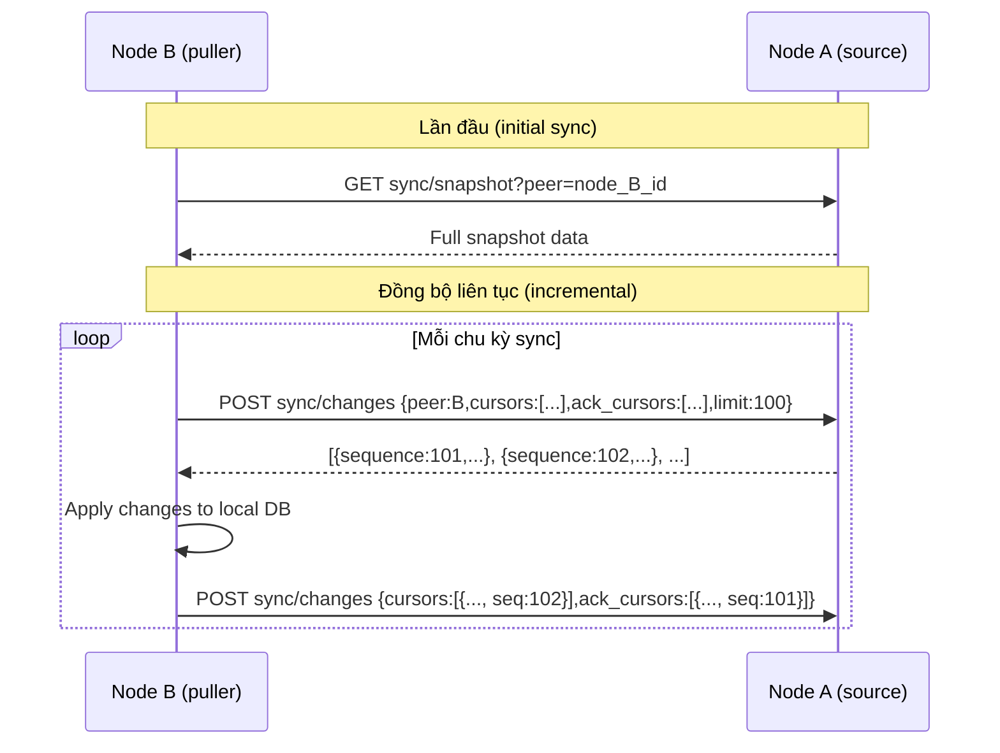
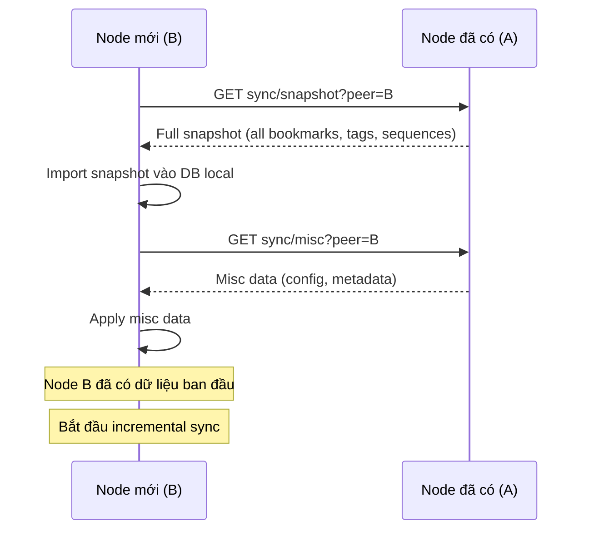
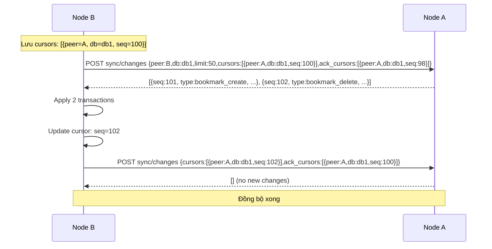

# Tài liệu API Đồng bộ Database ESC – Hướng dẫn tích hợp

## Tổng quan

Media server phải được build với `-DENABLE_SYNC_CHANGES=ON` để bật engine và các API đồng bộ database giữa các node. Tắt option này sẽ loại bỏ đồng bộ transaction/snapshot giữa node; đồng bộ camera với ESC vẫn là luồng độc lập.

Nhóm API `sync` cung cấp cơ chế **đồng bộ dữ liệu giữa các media server node** trong hệ thống multi-node ESC. Đây là API **nội bộ** (internal), được thiết kế để các node gọi lẫn nhau — **không phải để FE client gọi trực tiếp** trong luồng thông thường.

Tuy nhiên, FE/admin dashboard có thể sử dụng để **giám sát trạng thái đồng bộ** hoặc **trigger đồng bộ thủ công** khi cần debug.

### 3 API đồng bộ

| API | Mục đích |
|-----|---------|
| `POST /media/esc/sync/changes` | Lấy transaction log kể từ cursor nhất định |
| `GET /media/esc/sync/snapshot` | Lấy toàn bộ snapshot dữ liệu của một node |
| `GET /media/esc/sync/misc` | Lấy dữ liệu misc (cấu hình, metadata) của một node |

> **Lưu ý bảo mật**: Các API này **không có** `CHECK_AUTH_TOKEN()`. Chúng được bảo vệ bằng network isolation (chỉ node nội bộ mới có thể gọi). **Không expose** các endpoint này ra Internet.

---

## Kiến trúc đồng bộ

## Quy tắc phân phối camera và failover

Service API bên ngoài là authority duy nhất quyết định camera thuộc node nào. Media server không tự election, không tự promote camera khi peer offline và không dùng `SyncManager` để phân phối camera.

Luồng chuẩn trên mỗi media server là:

```text
Service API -> loadServerConfigJson(data_api) -> CameraManager::addCamera()
             -> setCameraOption() -> assign/release resource
```

`SyncManager` chỉ đồng bộ dữ liệu DB giữa các node: cấu hình camera, trạng thái resource và lịch sử assignment. Việc node failover nào nhận camera phải được service API gửi lại bằng cấu hình camera đầy đủ, bao gồm `device_id`, `streamUrls` và các policy recording.

### Move camera

1. Service API bỏ camera khỏi danh sách của node cũ (hoặc gửi cấu hình `enableActive=false`).
2. Node cũ **chỉ release assignment** của nó (`released_at`) và ngừng ghi ESC cho camera. Cấu hình "inactive" local của node cũ không được ghi lên ESC, vì cấu hình trên ESC thuộc về node nhận camera.
3. Service API gửi cấu hình `enableActive=true` cho node mới. Node mới gọi `addCamera()`, tạo assignment mới (`FAILOVER` nếu nó không phải `priMediaServerId`) và ghi cấu hình lên ESC.
4. Assignment cũ được đóng bằng `released_at`; lịch sử không bị xóa.

Khi camera quay lại một node đã từng chạy nó (hoặc node khởi động lại và service API gửi lại đúng cấu hình cũ), việc bật sync mode sẽ tự ghi lại assignment, cấu hình và trạng thái lên ESC, kể cả khi option không đổi.

> Chưa có cơ chế `ownershipGeneration` để chặn node cũ reconnect giành lại camera. Hiện tại, node tạo assignment sau sẽ đóng (`released_at`) assignment active của node khác, và khi đồng bộ, một assignment active có `assigned_at` cũ hơn assignment active đang có sẽ không được ghi. Service API vẫn là nơi quyết định camera chạy ở đâu.

### Xóa camera

Service API loại camera khỏi danh sách phân phối của mọi node.

- Node đang chạy camera: release assignment, tắt camera, rồi sau `manager.failoverActiveDelaySec` giây (mặc định 1800) xoá camera khỏi danh sách local.
- Node chỉ xoá resource/config/status của camera trên ESC (`vms_resource`, `vms_kvpair`, `vms_resource_status`) khi **không có node khác đang giữ assignment active**. Nếu còn node khác đang chạy camera (tức camera đã được chuyển đi, không phải bị xoá), ESC được giữ nguyên.
- Các lệnh xoá để lại tombstone (xem [Giải quyết xung đột](#giải-quyết-xung-đột-last-writer-wins)), nên cấu hình cũ gửi đến sau không làm camera sống lại. Các dòng `vms_resource_assignment` không bị xoá.

### Node offline và failover

1. Service API phát hiện node chính offline.
2. Service API chọn node failover và gửi lại toàn bộ cấu hình camera cho node đó.
3. Node failover chỉ khởi tạo camera khi nhận được cấu hình API, sau đó ghi assignment loại `FAILOVER`.
4. Khi node chính trở lại, service API quyết định move-back; media server chỉ áp dụng cấu hình mới.

Nếu service API không gửi cấu hình failover, DB sync một mình không làm camera chạy trên node khác.

### Dữ liệu ESC

`vms_kvpair` chỉ chứa cấu hình camera shared, trong đó `streamUrls` là cấu hình link RTSP và phải được đồng bộ. Các runtime statistic như stream status, transport và storage statistic không được ghi vào ESC resource KV.

`vms_resource_assignment` là append-only history về owner theo thời gian. Không dùng thao tác xóa toàn bộ assignment khi xóa camera.

### Mô hình Multi-node

```
┌─────────────┐         ┌─────────────┐         ┌─────────────┐
│   Node A    │◄────────│   Node B    │◄────────│   Node C    │
│  (master)   │         │ (replica)   │         │ (replica)   │
│  DB_A       │         │  DB_B       │         │  DB_C       │
└─────────────┘         └─────────────┘         └─────────────┘
      │                        │                        │
      └────────────────────────┴────────────────────────┘
                    Gossip / Push-Pull sync
```

- Mỗi node có **database riêng** chứa dữ liệu của camera mà node đó đang quản lý
- Đồng bộ theo cơ chế **incremental log** (transaction log) + **full snapshot** (khi mới join)
- Cursor-based sync: mỗi node lưu trữ "cursor" (sequence number) cho từng cặp `peer_guid/db_guid` để biết đã nhận đến đâu

### Luồng đồng bộ cơ bản



---

## API 1: Lấy Transaction Log

**POST** `/media/esc/sync/changes`

Trả về danh sách transaction log kể từ các cursor được gửi lên. Đây là API cốt lõi của cơ chế incremental sync.

### Request body (`application/json`)

| Tham số | Kiểu | Bắt buộc | Mô tả |
|---------|------|----------|-------|
| `peer` | `string` | ✅ | `mediaServerId` của node đang gọi |
| `db` | `string` | ✅ | GUID của database cần lấy log |
| `limit` | `int` | ✅ | Số lượng log tối đa trả về mỗi lần |
| `cursors` | `array` | ✅ | Danh sách cursor hiện tại của node gọi |
| `ack_cursors` | `array` | ✅ | Danh sách cursor đã xử lý xong (để server prune log cũ) |

```json
{
  "peer": "node-b-id",
  "db": "db-uuid-1",
  "limit": 100,
  "cursors": [
    {
      "peer_guid": "node-A-id",
      "db_guid": "db-uuid-1",
      "sequence": 100
    }
  ],
  "ack_cursors": [
    {
      "peer_guid": "node-A-id",
      "db_guid": "db-uuid-1",
      "sequence": 98
    }
  ]
}
```

#### Format `cursors`

```json
[
  {
    "peer_guid": "node-A-id",
    "db_guid": "db-uuid-1",
    "sequence": 100
  },
  {
    "peer_guid": "node-A-id",
    "db_guid": "db-uuid-2",
    "sequence": 55
  }
]
```

> Server sẽ trả về tất cả transaction có `sequence > cursor.sequence` cho mỗi cặp `peer/db`. Code hiện tại đọc `cursors` từ JSON body, không cần stringify array thành query string.

#### Format `ack_cursors`

```json
[
  {
    "peer_guid": "node-A-id",
    "db_guid": "db-uuid-1",
    "sequence": 98
  }
]
```

> `ack_cursors` báo cho server biết node đã xử lý đến sequence nào để server có thể xóa log cũ (compaction).

#### Response thành công (`200`)

```json
{
  "code": 0,
  "data": [
    {
      "sequence": 101,
      "peer_guid": "node-A-id",
      "db_guid": "db-uuid-1",
      "timestamp": 1717200000,
      "timestamp_hi": 1717200000500,
      "tran_guid": "tran-uuid-abc",
      "tran_type": "bookmark_create",
      "tran_data": "{\"id\":\"bm-123\",\"name\":\"Test\", ...}"
    },
    {
      "sequence": 102,
      "peer_guid": "node-A-id",
      "db_guid": "db-uuid-1",
      "timestamp": 1717200001,
      "timestamp_hi": 1717200001200,
      "tran_guid": "tran-uuid-def",
      "tran_type": "bookmark_delete",
      "tran_data": "{\"id\":\"bm-456\"}"
    }
  ]
}
```

#### Giải thích các field trong mỗi log entry

| Field | Kiểu | Mô tả |
|-------|------|-------|
| `sequence` | `int64` | Số thứ tự tăng dần, dùng làm cursor cho lần pull tiếp theo |
| `peer_guid` | `string` | GUID của node nguồn tạo ra transaction này |
| `db_guid` | `string` | GUID của database chứa dữ liệu |
| `timestamp` | `int64` | Thời điểm ghi (Unix epoch, millisecond). Cùng với `peer_guid`, đây là version dùng để giải quyết xung đột (xem [Giải quyết xung đột](#giải-quyết-xung-đột-last-writer-wins)) |
| `timestamp_hi` | `int` | Cờ audit do node nhận ghi lại: `0` = áp dụng bình thường, `1` = thắng một version cũ hơn, `2` = bị bỏ qua vì đã có version mới hơn, `3` = bị hoãn vì bản build không hiểu được entry |
| `tran_guid` | `string` | GUID duy nhất của transaction (dùng để dedup) |
| `tran_type` | `string` | Loại transaction, ví dụ: `bookmark_create`, `bookmark_update`, `bookmark_delete` |
| `tran_data` | `string` | JSON data của transaction (nội dung phụ thuộc `tran_type`) |

#### Cơ chế xử lý cursor

`sync/changes` gọi `SyncManager::getCurrentCursors(cursors, limit)`. Node gọi nên gửi đủ các cursor đang lưu. Nếu muốn pull từ đầu, gửi cursor `sequence = 0` cho cặp `peer_guid/db_guid` tương ứng.

#### Giải quyết xung đột (last-writer-wins)

Mỗi dòng dữ liệu được đồng bộ có một version lưu bền vững trong bảng `sync_row_version` của DB ESC (migration `09_sync_row_version.sql`):

- **Version** = (`timestamp`, `peer_guid`) của transaction đã ghi dòng đó. Version nào có `timestamp` lớn hơn thì mới hơn; nếu bằng nhau thì so `peer_guid`. Vì vậy mọi node đều chọn cùng một kết quả, bất kể thứ tự nhận log.
- **Khoá dòng:** `vms_resource`/`vms_resource_status` dùng `guid`; `vms_resource_assignment` dùng `assignment_guid`; `bookmark_index` dùng `bookmark_guid`; `vms_kvpair` dùng `resource_guid:name`. Với `vms_kvpair`, mỗi item trong `UPSERT_BATCH` được so sánh riêng.
- **Log bị bỏ qua:** log có version cũ hơn version đã lưu vẫn được ghi vào `transaction_log` (với `timestamp_hi = 2`) để relay tiếp và cursor vẫn tiến, nhưng dữ liệu không đổi.
- **`DELETE`:** để lại tombstone (`deleted = 1`), nên một `UPSERT` cũ hơn không làm dòng sống lại. Với `vms_kvpair`, `DELETE` xoá theo nhóm (toàn bộ kv của một resource); các item được ghi sau lệnh xoá vẫn được giữ lại.
- **Ghi local:** cũng được ghi version. Timestamp của log được đẩy lên lớn hơn version đã biết của các dòng liên quan, nên node có đồng hồ chậm vẫn không thua dữ liệu mà chính nó đã nhận trước đó.
- **Dọn tombstone:** tombstone cũ hơn `database.row_version_tombstone_ttl_days` (mặc định 30 ngày) sẽ bị xoá. Giá trị này phải lớn hơn thời gian tối đa một node có thể offline mà vẫn tiếp tục bằng pull incremental.

Version, dữ liệu, `transaction_log` và cursor được ghi trong cùng một transaction, nên một batch lỗi được áp dụng lại nguyên vẹn ở lần pull sau.

#### Gap, entry bị hoãn và prune log

- **Gap:** cursor của mỗi nguồn (`peer_guid/db_guid`) chỉ tiến tuần tự. Nếu relay trả về entry có `sequence` lớn hơn `cursor + 1` (relay đã prune phần giữa, hoặc chưa từng nhận được), node **không** áp dụng các entry của nguồn đó trong batch, và cursor giữ nguyên.
  - Nếu relay khác bù được phần thiếu thì đồng bộ tiếp tục bình thường.
  - Nếu cursor vẫn đứng yên sau 3 chu kỳ pull, node ghi trạng thái bootstrap `pending` (kèm lý do) và **resync toàn bộ từ snapshot** của một peer.
- **Entry không hiểu được** (table, op hoặc `tran_type` lạ; `tran_data` hỏng): vẫn được lưu vào `transaction_log` với `timestamp_hi = 3` để relay tiếp cho node khác, và cursor vẫn tiến. Khi node khởi động bằng bản build hiểu được entry đó, `SyncManager` áp dụng lại chúng (LWW bảo đảm việc áp dụng muộn vẫn đúng).
- **Ack:** `transaction_peer_ack_log` lưu theo khoá (`peer_guid`, `src_peer_guid`, `src_db_guid`) (migration `10_peer_ack_log_src_db_key.sql`). `updated_at` (unix giây) là lần cuối peer báo ack, dùng như "last seen".
- **Prune:** watermark để xoá log gồm các peer đang healthy, cộng các peer đã biết trong cluster (cùng `serverGroupId`) đang offline nhưng đã ack trong vòng `database.peer_offline_ttl_days` ngày (mặc định 7). Peer offline lâu hơn thời hạn đó, hoặc chưa từng ack, không giữ log lại; khi quay lại, nó sẽ gặp gap và tự resync từ snapshot. Nên đặt `database.row_version_tombstone_ttl_days` ≥ `database.peer_offline_ttl_days`.

| Config | Mặc định | Ý nghĩa |
|---|---|---|
| `database.transaction_log_keep_last` | 1000 | Số entry giữ lại dưới watermark ack |
| `database.peer_offline_ttl_days` | 7 | Thời gian một peer offline còn giữ watermark prune |
| `database.row_version_tombstone_ttl_days` | 30 | Thời gian giữ tombstone của `sync_row_version` |

---

## API 2: Lấy Full Snapshot

**GET / POST** `/media/esc/sync/snapshot`

Trả về toàn bộ dữ liệu hiện tại của node dưới dạng snapshot. Dùng khi một node mới join cụm và cần khởi tạo trạng thái ban đầu.

### Request params

| Tham số | Kiểu | Bắt buộc | Mô tả |
|---------|------|----------|-------|
| `peer` | `string` | ✅ | `mediaServerId` của node cần snapshot – phải là ID của node được gọi |

> Nếu `peer` không khớp với `mediaServerId` của node đang nhận request → lỗi `902006` (Media server not found). Điều này ngăn node B request snapshot của node C thông qua node A.

### Response thành công (`200`)

`data` là một chuỗi JSON (`SnapshotBuilder::serialize()`) có dạng:

```json
{
  "peer_id": "node-a",
  "db_guid": "…",
  "sequences": [ … ],
  "vms_resource": [ … ],
  "vms_kvpair": [ … ],
  "vms_resource_status": [ … ],
  "resource_assignment": [ … ],
  "bookmark_index": [ … ],
  "row_versions": [ … ]
}
```

> `row_versions` là nội dung bảng `sync_row_version` (có từ migration 09; snapshot từ node cũ không có trường này). Node nhận không ghi đè một dòng mà nó đã có version mới hơn version trong snapshot.

### Mã lỗi

| `code` | HTTP | Mô tả |
|--------|------|--------|
| `902006` | 404 | Node không tìm thấy (peer ID không khớp) |

---

## API 3: Lấy Misc Data

**GET / POST** `/media/esc/sync/misc`

Trả về các dữ liệu miscellaneous (cấu hình, metadata dạng key-value) của một node.

### Request params

| Tham số | Kiểu | Bắt buộc | Mô tả |
|---------|------|----------|-------|
| `peer` | `string` | ✅ | `mediaServerId` của node cần lấy misc data |

### Response thành công (`200`)

```json
{
  "code": 0,
  "data": {
    "config_key_1": "value_1",
    "config_key_2": "value_2"
  }
}
```

> Các key rỗng hoặc value rỗng sẽ được lọc ra và không xuất hiện trong kết quả.

---

## Luồng đồng bộ chi tiết

### Initial Sync (Node mới join)



### Incremental Sync (Chu kỳ thường xuyên)



---

## Hướng dẫn sử dụng cho Admin/Monitoring

### Kiểm tra trạng thái đồng bộ

```js
// Lấy snapshot của node để kiểm tra dữ liệu hiện tại
const getNodeSnapshot = async (nodeUrl, mediaServerId) => {
  const res = await fetch(`${nodeUrl}/media/esc/sync/snapshot?peer=${mediaServerId}`);
  const json = await res.json();
  if (json.code !== 0) throw new Error(json.msg);
  return json.data;
};

// So sánh số lượng bookmark giữa các node
const compareNodes = async (nodes) => {
  const snapshots = await Promise.all(
    nodes.map(({ url, id }) => getNodeSnapshot(url, id))
  );
  return snapshots.map((snap, i) => ({
    node: nodes[i].id,
    bookmarkCount: snap.bookmarks?.length ?? 0,
  }));
};
```

### Kéo incremental changes thủ công

```js
// Pull changes từ node nguồn về node hiện tại
const pullChanges = async (sourceNodeUrl, currentNodeId, cursors, ackCursors, limit = 100) => {
  const res = await fetch(`${sourceNodeUrl}/media/esc/sync/changes`, {
    method: 'POST',
    headers: { 'Content-Type': 'application/json' },
    body: JSON.stringify({
      peer: currentNodeId,
      db: 'db-uuid',
      limit,
      cursors,
      ack_cursors: ackCursors,
    }),
  });
  const json = await res.json();
  return json.data; // mảng transaction log
};

// Ví dụ: pull từ đầu (cursor = 0)
const changes = await pullChanges(
  'http://node-a:8080',
  'node-b-id',
  [{ peer_guid: 'node-a-id', db_guid: 'db-uuid', sequence: 0 }],
  [] // chưa ack gì
);
```

---

## Cấu trúc Transaction Types

Các loại `tran_type` hiện tại trong hệ thống:

| `tran_type` | Mô tả | `tran_data` chứa |
|-------------|-------|-----------------|
| `bookmark_create` | Tạo bookmark mới | Object bookmark đầy đủ |
| `bookmark_update` | Cập nhật bookmark | Object bookmark đã cập nhật |
| `bookmark_delete` | Xóa bookmark | `{"id": "bm-guid"}` |

---

## Lưu ý quan trọng

1. **API này là internal**: Không authenticate bằng JWT user. Bảo vệ bằng network firewall/VPN giữa các node. **Không expose ra Internet.**

2. **`peer` phải đúng**: API `snapshot` và `misc` kiểm tra `peer == mediaServerId` của node nhận. Nếu sai sẽ trả về lỗi 404. Điều này tránh node A làm proxy cho node B khi gọi node C.

3. **Idempotency**: Transaction log có `tran_guid` duy nhất. Khi apply, node nhận cần kiểm tra `tran_guid` để tránh apply duplicate khi network retry.

4. **Cursor persistence**: Node cần lưu cursor vào DB local (không chỉ memory) để sau khi restart vẫn tiếp tục sync từ đúng vị trí.

5. **`ack_cursors` quan trọng**: Nếu không gửi `ack_cursors`, server không biết có thể prune log cũ → log tích lũy không giới hạn → tốn disk. Cần ack đúng sequence sau khi đã apply thành công.

6. **`limit` hợp lý**: Đặt `limit` vừa phải (50-200) để tránh timeout và quá tải network. Nếu còn nhiều hơn `limit` bản ghi, node cần loop gọi liên tiếp cho đến khi nhận được mảng rỗng.
