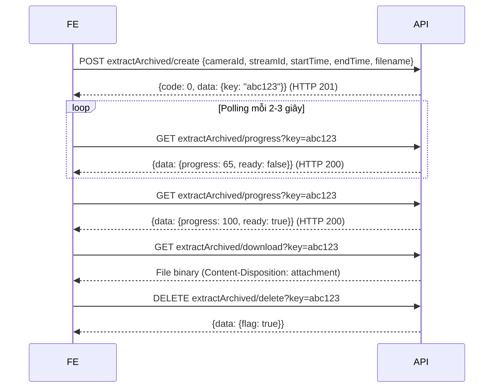

# Tài liệu API Timeline & Thumbnail – Hướng dẫn tích hợp Frontend

## Tổng quan

Nhóm API này phục vụ các chức năng:
1. **Timeline** – Lấy danh sách khoảng thời gian đã có recording (`recordedTimePeriod`)
2. **Thumbnail từ timeline** – Chụp ảnh JPEG tại một thời điểm cụ thể trong recording (`recordedThumnail`)
3. **Motion Search** – Tìm khoảng thời gian có phát hiện chuyển động theo vùng ROI (`searchMotion`)
4. **Extract Video** – Trích xuất đoạn video từ recording ra file để download (`extractArchived`)

Tất cả API đều yêu cầu:
- **JWT token** hợp lệ qua header `Authorization: Bearer <jwt>`
- **Quyền Playback** (permission code `"1003"`) cho timeline, thumbnail và motion search
- **Quyền Extract** (permission code `"1004"`) cho các API `extractArchived/*`

---

## Cấu trúc Response chung

```json
{
  "code": 0,
  "msg": "Success",
  "data": { ... }
}
```

### Mã lỗi phổ biến

| `code` | HTTP | Mô tả |
|--------|------|--------|
| `0` | 200 | Thành công |
| `901001` | 401 | Chưa xác thực |
| `901004` | 401 | Không có quyền Playback |
| `901009` | 401 | Không có quyền Extract |
| `902001` | 400 | Thiếu hoặc sai tham số |
| `902003` | 400 | Extension file không hợp lệ |
| `903001` | 404 | Không có dữ liệu timeline trong khoảng thời gian |
| `904001` | 404 | Snapshot rỗng hoặc FFmpeg không tạo được thumbnail |
| `904002` | 504 | Restore hoặc FFmpeg chưa hoàn tất trong timeout của request |
| `902009` | 404 | Khoảng thời gian không hợp lệ |
| `905001` | 404 | Camera không tìm thấy |
| `909001` | 404 | Extract key không tìm thấy |
| `-1` | 500 | Extract video thất bại, không xác định được nguyên nhân (chi tiết ở `msg`) |
| `909003` | 500 | Khoảng thời gian extract không có dữ liệu |
| `914004` | 503 | Storage pool chứa recording đang offline |
| `914019` | 500 | Không tạo được restore job cho dữ liệu COLD |

---

## Phần 1: Timeline

### 1.1 Lấy danh sách khoảng thời gian đã ghi

**GET / POST** `/media/esc/recordedTimePeriod`

Trả về các khoảng thời gian có dữ liệu recording cho một camera trong khoảng `[startTime, endTime]`. Dùng để vẽ thanh timeline trên UI playback.

#### Request params

| Tham số | Kiểu | Bắt buộc | Mô tả |
|---------|------|----------|-------|
| `cameraId` | `string` | ✅ | ID camera |
| `startTime` | `uint64` | ✅ | Unix timestamp (giây) bắt đầu tìm (0 = 24 giờ trước) |
| `endTime` | `uint64` | ✅ | Unix timestamp (giây) kết thúc tìm (0 = hiện tại) |
| `periodType` | `int` | ✅ | Kiểu phân nhóm khoảng thời gian (0 = raw blocks, 1 = merged) |
| `detail` | `int` | ✅ | Mức độ chi tiết (0 = chỉ khoảng, 1 = có metadata) |
| `motion` | `bool` | ❌ | Kèm thông tin chuyển động hay không (`true`/`false`) |

#### Response thành công (`200`)

```json
{
  "code": 0,
  "msg": "",
  "data": [
    {
      "start": 1717190000,
      "end": 1717193600
    },
    {
      "start": 1717194000,
      "end": 1717200000
    }
  ]
}
```

> Mỗi phần tử là một khoảng liên tục có dữ liệu recording. Dùng để tô màu trên thanh timeline.

#### Ví dụ

```js
const getTimeline = async (cameraId, startTime, endTime, jwtToken) => {
  const query = new URLSearchParams({
    cameraId,
    startTime,
    endTime,
    periodType: 1,
    detail: 0,
  });
  const res = await fetch(`/media/esc/recordedTimePeriod?${query}`, {
    headers: { Authorization: `Bearer ${jwtToken}` },
  });
  return res.json();
};
```

---

### 1.2 Lấy Thumbnail tại thời điểm trên timeline

**GET / POST** `/media/esc/recordedThumnail`

> Route hiện tại trong code là `recordedThumnail`. Nếu FE muốn đặt tên hàm là `thumbnail`, vẫn cần gọi đúng path này.

Trả về ảnh JPEG được chụp từ file recording tại hoặc gần nhất với thời điểm `pos`. Server dùng FFmpeg để extract frame từ file MP4.

Nếu camera được cấu hình watermark hoặc privacy mask, ảnh thumbnail sẽ được render theo chính sách của camera và role của JWT hiện tại. Chính sách này được áp dụng ở node đang sở hữu recording; client không thể tắt overlay bằng request.

#### Request params

| Tham số | Kiểu | Bắt buộc | Mô tả |
|---------|------|----------|-------|
| `cameraId` | `string` | ✅ | ID camera |
| `pos` | `string` | ✅ | Unix timestamp (giây) hoặc `"latest"` để lấy frame mới nhất |
| `streamId` | `string` | ❌ | ID stream cụ thể (để trống = stream mặc định) |
| `edge` | `bool/int` | ❌ | Dùng nội bộ khi node forward request |

#### Response thành công (`200`)

- **Content-Type:** `image/jpeg`
- **Body:** Binary JPEG data (trả về trực tiếp, không wrap JSON)

Nếu segment đang ở COLD tier, server tự chọn presigned URL hoặc restore rồi chạy
FFmpeg trong cùng request; FE không cần retry. Timeout mặc định là 5 giây. Nếu tác vụ
chưa hoàn tất, API trả HTTP `504`, code `904002` và trạng thái hiện tại:

```json
{"code":904002,"msg":"Recorded thumbnail processing timed out","data":{"status":"TIMEOUT","stage":"RESTORING","progressPercent":12.0}}
```

Restore job ID và presigned URL là chi tiết nội bộ, không được trả về client.

#### Mã lỗi riêng

| `code` | Mô tả |
|--------|-------|
| `903001` | Không có file recording tại thời điểm yêu cầu |
| `904001` | FFmpeg không thể extract frame hoặc không render được overlay |
| `904002` | Restore/FFmpeg chưa xong trong timeout (HTTP `504`) |
| `914004` | Storage pool chứa segment đang offline (HTTP `503`) |
| `914019` | Không tạo được restore job (HTTP `500`) |

Với `pos` là timestamp, server tìm segment bắt đầu trước `pos` trong khoảng `[pos - 60, pos + 60]`. Với `pos=latest` (hoặc `0`), server lấy frame khoảng 10 giây trước điểm kết thúc của block ghi gần nhất.

#### Cơ chế cache

- Thumbnail được cache vào disk (`api.snapRoot`) theo timestamp và chính sách overlay hiệu lực của request.
- Handler không đặt thời hạn cho cache: nếu file cache tồn tại và khác rỗng → trả về ngay, không gọi lại FFmpeg.
- Với `pos=latest`, timestamp thực tế thay đổi theo dữ liệu ghi mới nên sẽ tạo ảnh mới khi recording tiến lên.

#### Ví dụ

```jsx
// React – hiển thị thumbnail tại thời điểm khi hover trên timeline
const TimelineThumbnail = ({ cameraId, timestamp, jwtToken }) => {
  const src = `/media/esc/recordedThumnail?cameraId=${cameraId}&pos=${timestamp}`;
  return (
     { e.target.style.display = 'none'; }}
    />
  );
};

// Lấy thumbnail ảnh mới nhất
const getLatestThumbnail = (cameraId) =>
  `/media/esc/recordedThumnail?cameraId=${cameraId}&pos=latest`;
```

---

## Phần 2: Motion Search

### 2.1 Tìm kiếm khoảng thời gian có chuyển động

**GET / POST** `/media/esc/searchMotion`

Tìm các khoảng thời gian có phát hiện chuyển động trong một vùng ROI (Region of Interest) xác định bởi mask.

#### Request params

| Tham số | Kiểu | Bắt buộc | Mô tả |
|---------|------|----------|-------|
| `cameraId` | `string` | ✅ | ID camera |
| `startTime` | `uint64` | ✅ | Unix timestamp bắt đầu (0 = 24 giờ trước) |
| `endTime` | `uint64` | ✅ | Unix timestamp kết thúc (0 = hiện tại) |
| `roiMask` | `string` | ✅ | Chuỗi mask định nghĩa vùng ROI (format phụ thuộc backend) |

#### Response thành công (`200`)

```json
{
  "code": 0,
  "msg": "",
  "data": [
    { "start": 1717190500, "end": 1717190530 },
    { "start": 1717191200, "end": 1717191260 }
  ]
}
```

#### Ví dụ

```js
const searchMotion = async ({ cameraId, startTime, endTime, roiMask }, jwtToken) => {
  const res = await fetch('/media/esc/searchMotion', {
    method: 'POST',
    headers: {
      'Content-Type': 'application/json',
      Authorization: `Bearer ${jwtToken}`,
    },
    body: JSON.stringify({ cameraId, startTime, endTime, roiMask }),
  });
  return res.json();
};
```

---

## Phần 3: Extract Video (Trích xuất đoạn video)

Extract là tính năng cho phép user chọn một đoạn video từ recording và trích xuất ra file `.mp4`/`.mkv`/`.avi` để download. Quá trình extract chạy bất đồng bộ, FE cần polling để kiểm tra tiến độ.

### Luồng hoạt động



---

### 3.1 Tạo tác vụ Extract

**POST** `/media/esc/extractArchived/create`

#### Request body

| Tham số | Kiểu | Bắt buộc | Mô tả |
|---------|------|----------|-------|
| `cameraId` | `string` | ✅ | ID camera |
| `streamId` | `string` | ✅ | ID stream (để trống nếu chỉ có 1 stream) |
| `startTime` | `string/int64` | ✅ | Unix timestamp bắt đầu |
| `endTime` | `string/int64` | ✅ | Unix timestamp kết thúc |
| `filename` | `string` | ✅ | Tên file đầu ra (phải có đuôi `.mp4`, `.mkv`, hoặc `.avi`) |
| `description` | `string` | ❌ | Mô tả đoạn video |
| `stampSource` | `bool` | ❌ | Mặc định `false`. Khi bật, ghi thêm dấu nguồn gồm tên camera và user thực hiện extract vào video. Dấu nguồn được áp dụng độc lập và có thể xuất hiện đồng thời với watermark/privacy mask của camera. |

#### Response thành công (`201 Created`)

```json
{
  "code": 0,
  "msg": "",
  "data": {
    "key": "a1b2c3d4e5f6..."
  }
}
```

> Lưu `key` này để dùng cho các API tiếp theo. `key` là MD5 của `(camera, stream, startTime, endTime, filename)`: gọi lại `create` với đúng tham số khi tác vụ còn tồn tại sẽ trả lại key cũ, không tạo tác vụ mới.
>
> Sau khi extract kết thúc, tác vụ (key + file) được giữ trong `ffmpeg.delay_close_sec` giây (mặc định 300) rồi tự xoá. Tác vụ chạy trên node nhận request `create`; các API progress/download/delete phải gọi vào cùng node.

Nếu cửa sổ extract có dữ liệu ở COLD tier, API vẫn trả key ngay. `FFmpegExtractor` tự
chọn stream khi cần, chọn presigned URL hoặc restore theo chế độ HYBRID, theo dõi restore
và chuyển sang FFmpeg trong cùng task. Client chỉ polling API progress bằng key, không
gọi lại API create.

#### Lỗi đặc biệt

| `code` | Mô tả |
|--------|-------|
| `905001` | Camera không tìm thấy |
| `902003` | Extension file không hợp lệ (chỉ chấp nhận .mp4, .mkv, .avi) |
| `909003` | Khoảng thời gian không có dữ liệu recording |
| `-1` | Tạo extract thất bại, không xác định được nguyên nhân |

---

### 3.2 Kiểm tra tiến độ Extract

**GET** `/media/esc/extractArchived/progress?key={key}`

JWT gọi API không cần trùng với JWT đã tạo tác vụ. API cho phép truy cập khi JWT có quyền Extract (`1004`) và có quyền truy cập camera của tác vụ tại thời điểm kiểm tra.

#### Response (`200 OK`)

```json
{
  "code": 0,
  "msg": "",
  "data": {
    "progress": 72.0,
    "ready": false
  }
}
```

| Field | Kiểu | Mô tả |
|-------|------|-------|
| `progress` | `float` | Tiến độ chung từ 0 đến 100; nếu cần restore thì restore chiếm 0-30, FFmpeg chiếm 30-100 |
| `ready` | `bool` | `true` khi extract hoàn tất và có thể download |

API không trả `status`/`stage`. Khi tác vụ thất bại, API trả lỗi thay vì `data`.

#### Lỗi

| `code` | HTTP | Mô tả |
|--------|------|-------|
| `909001` | 404 | Key không tìm thấy (sai key, đã xoá hoặc đã hết thời gian giữ) |
| `909003`, `914009`, `914019` | | Extract thất bại vì nguyên nhân đã biết (không có dữ liệu, cần restore, không tạo được restore job). FE dừng polling |
| `-1` | 500 | Extract thất bại không rõ nguyên nhân; `msg` có dạng `Extract video failed: <chi tiết>`. FE dừng polling |

---

### 3.3 Download file đã Extract

**GET** `/media/esc/extractArchived/download?key={key}`

Chỉ gọi khi `ready: true`. Trả về file binary với header `Content-Disposition: attachment;filename="..."`. Nếu tác vụ chưa xong hoặc đã thất bại, API trả `909001`.

API yêu cầu header `Authorization`, vì vậy không dùng thẻ `<a href>` trực tiếp mà tải bằng `fetch`.

#### Ví dụ

```js
const downloadExtract = async (key, token, filename) => {
  const res = await fetch(`/media/esc/extractArchived/download?key=${key}`, {
    headers: { Authorization: `Bearer ${token}` },
  });
  if (!res.ok) throw new Error((await res.json()).msg);
  const url = URL.createObjectURL(await res.blob());
  const a = document.createElement('a');
  a.href = url;
  a.download = filename;
  a.click();
  URL.revokeObjectURL(url);
};
```

---

### 3.4 Xóa tác vụ Extract

**GET / DELETE** `/media/esc/extractArchived/delete?key={key}`

Giải phóng tài nguyên và xóa file đã extract trên server.

Điều kiện phân quyền giống API progress: JWT phải có quyền Extract (`1004`) và có quyền truy cập camera của tác vụ. Xóa tác vụ đang chạy sẽ dừng tiến trình FFmpeg, sau đó xoá file đầu ra và key.

#### Response (`200`)

```json
{
  "code": 0,
  "data": { "flag": true }
}
```

Nếu key không tồn tại, API vẫn trả `200` với `flag: false`.

---

### 3.5 Danh sách tác vụ Extract đang chạy

**GET** `/media/esc/extractArchived/list`

Lấy danh sách tất cả tác vụ extract thuộc JWT token hiện tại.

#### Response (`200`)

```json
{
  "code": 0,
  "data": [
    { "key": "abc123", "progress": 100.0, "ready": true },
    { "key": "def456", "progress": 30.0, "ready": false }
  ]
}
```

---

### 3.0 Kiểm tra dữ liệu trước khi Extract

**GET** `/media/esc/extractArchived/previews`

Kiểm tra khoảng thời gian có recording và tổng thời lượng thực tế có thể xuất, không tạo file và không chạy FFmpeg.

#### Request params

| Tham số | Kiểu | Bắt buộc | Mô tả |
|---------|------|----------|-------|
| `cameraId` | `string` | Có | ID camera |
| `streamId` | `string` | Không | Stream cụ thể; bỏ trống để dùng stream có dữ liệu dài nhất |
| `startTime` | `uint64` | Có | Unix timestamp bắt đầu |
| `endTime` | `uint64` | Có | Unix timestamp kết thúc |

#### Response thành công (`200`)

```json
{
  "code": 0,
  "msg": "",
  "data": {
    "hasData": true,
    "availableDuration": 120,
    "streamId": "main",
    "streamName": "Main stream"
  }
}
```

`availableDuration` tính bằng giây, chỉ gồm phần giao với khoảng yêu cầu và không tính các khoảng trống giữa các recording block. Khi không có dữ liệu, API vẫn trả `200` với `hasData: false` và `availableDuration: 0`.

`streamId` và `streamName` là stream có `availableDuration` lớn nhất, tức stream sẽ được dùng khi extract không chỉ định `streamId`. Khi không có dữ liệu hoặc không tìm thấy metadata tên stream, các field này là chuỗi rỗng.

Khoảng thời gian phải thỏa `startTime < endTime`; nếu không, API trả lỗi `902009`.

---

## Ví dụ hoàn chỉnh: Extract + Download

```js
// 1. Tạo tác vụ
const createRes = await fetch('/media/esc/extractArchived/create', {
  method: 'POST',
  headers: { 'Content-Type': 'application/json', Authorization: `Bearer ${token}` },
  body: JSON.stringify({
    cameraId: 'cam-001',
    streamId: '',
    startTime: 1717190000,
    endTime: 1717190120,
    filename: 'clip_20240601.mp4',
    description: 'Incident clip',
    stampSource: true,
  }),
});
const { data: { key } } = await createRes.json();

// 2. Polling tiến độ
const waitForExtract = (key, token) => new Promise((resolve, reject) => {
  const interval = setInterval(async () => {
    const res = await fetch(`/media/esc/extractArchived/progress?key=${key}`, {
      headers: { Authorization: `Bearer ${token}` },
    });
    const json = await res.json();
    if (json.code !== 0) { clearInterval(interval); reject(new Error(json.msg)); }
    if (json.data.ready) { clearInterval(interval); resolve(); }
  }, 2000);
});

await waitForExtract(key, token);

// 3. Download (xem downloadExtract ở mục 3.3)
await downloadExtract(key, token, 'clip_20240601.mp4');

// 4. Cleanup (tùy chọn)
await fetch(`/media/esc/extractArchived/delete?key=${key}`, {
  headers: { Authorization: `Bearer ${token}` },
});
```

---

## Lưu ý quan trọng

1. **Thumbnail cache**: Ảnh đã tạo cho cùng timestamp và chính sách overlay được trả lại từ cache, không chạy lại FFmpeg. Khi hover timeline, FE nên debounce và làm tròn `pos` về bước cố định (ví dụ 10 giây) để tận dụng cache. Thẻ `` không gửi được header `Authorization`, nên dùng `fetch` + blob URL.

2. **`pos=latest`**: Trả về thumbnail của frame cuối cùng được ghi. Dùng để preview trạng thái camera trên dashboard.

3. **Thời gian giữ kết quả extract**: Sau khi extract kết thúc (thành công hoặc thất bại), key và file chỉ được giữ `ffmpeg.delay_close_sec` giây (mặc định 300) rồi tự xoá. Nếu cấu hình giá trị này bằng `0`, file bị xoá ngay khi hoàn tất và không thể download. FE nên download ngay khi `ready: true`. Có thể lưu key vào `sessionStorage` để tiếp tục polling khi user quay lại trong thời gian tác vụ còn chạy.

4. **File size giới hạn**: Không có giới hạn cứng từ API, nhưng extract đoạn quá dài (>1 giờ) có thể mất nhiều thời gian và tốn dung lượng disk trên server.

5. **Phân quyền**: Timeline, thumbnail và motion dùng quyền Playback (`1003`). Extract dùng quyền Extract (`1004`). Tất cả API đều kiểm tra quyền của user với camera cụ thể.

6. **Cold storage**: Khi bật `PRESIGNED` hoặc `HYBRID`, thumbnail và extract có thể đọc trực tiếp object storage. Presigned URL không xuất hiện trong response nhưng có thể nằm trong manifest/log FFmpeg tạm và được dọn cùng file tạm. Nếu cần restore, task extract giữ nguyên key và API progress trả `progress` trong khoảng 0-30 cho tới khi restore xong.
