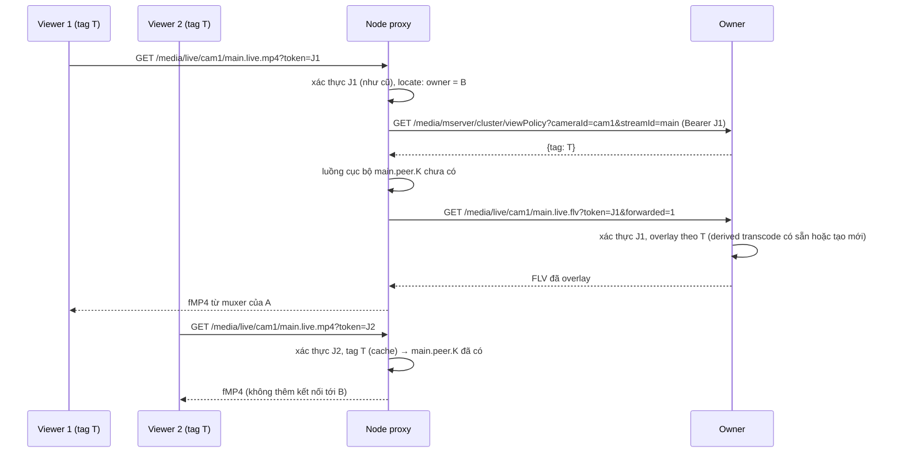

# Plan: proxy luồng media sang node owner trong cụm origin (gom viewer)

## 1. Bối cảnh và quyết định

Hiện chỉ metadata đi xuyên node (`recordedTimePeriod`, `recordedThumnail`, bookmark — tìm owner bằng
`SearchEngine::findCurrentOwnerNode`/`findOwnerNodeAtTime`). Live của camera không ở node này chờ
`maxStreamWaitMS` rồi 404; replay chỉ mở bản ghi cục bộ (403 `OverlayForbidden` nếu camera chưa từng ở
node, 404 ở đoạn node khác ghi).

Đã chốt (2026-10-14):

| # | Quyết định |
|---|---|
| Q1 | Proxy giữa các origin trong cụm, nằm trong MediaServer (không phải Edge Media Server riêng) |
| Q2 | **Owner** render overlay; node nhận request (*node proxy*) chỉ chuyển dữ liệu, không overlay lần hai |
| Q3 | Owner tin upstream bằng **JWT của viewer** (không thêm secret node↔node); JWT được đặt trong query |
| Q4 | Node proxy phải **chia tải** cho owner: nhiều viewer cùng luồng + cùng policy overlay dùng **một** upstream |

Phương án tunnel byte (một kết nối owner cho mỗi viewer) bị loại vì không chia tải được (Q4).

## 2. Ý tưởng

Owner đã đặt tên luồng overlay theo **tag policy** (`makeViewOverlayPolicyTag`), viewer cùng tag dùng
chung một derived transcode. Node proxy làm giống vậy ở phía mình:

1. Xác thực viewer tại node proxy như hiện nay (JWT, `on_play`, author cache, gia hạn/thu hồi phiên).
2. Hỏi owner **tag policy của viewer này** (owner là nơi có cấu hình overlay của camera).
3. Đổi luồng viewer yêu cầu sang tên cục bộ `"{stream}.peer.{key}"`, `key` = MD5(owner, tag, tham số
   chọn dữ liệu/replay/transcode).
4. Chưa có → kéo **một** upstream HTTP-FLV từ owner bằng JWT của viewer (owner render overlay đúng tag
   đó), đăng ký `MediaSource` cục bộ dưới tên ở bước 3. Viewer sau cùng tag dùng lại.
5. Mọi đầu ra HTTP/WS/HLS cho viewer sinh từ `MultiMediaSourceMuxer` của node proxy.

Owner chỉ còn: overlay transcode mỗi tag (như hiện tại) + **một reader cho mỗi (node proxy, luồng, tag)**.
TLS, mux, socket, HLS session của từng viewer chuyển sang node proxy.

Upstream dùng **HTTP-FLV** vì: owner chỉ render overlay trên đầu ra HTTP/HLS (RTSP/RTMP phát luồng gốc —
kéo bằng RTSP sẽ rò luồng không overlay), và `PlayerBase` có player FLV nhưng không có player fMP4.

## 3. Phạm vi

| Đầu vào viewer tại node proxy | Đợt này |
|---|---|
| HTTP-FLV/TS/fMP4, WS-FLV/fMP4, HLS/HLS-fMP4 live | Có |
| `.live2.mp4?quality=…` live và replay gộp | Có (cần P6 ở owner) |
| Replay per-stream `/media/record/{cam}/{stream}/vod/{stamp}.live.*` | Có |
| Reduce-quality `transcode=true&target_*` | Có — owner transcode, khoá gom gồm tham số |
| `/media/mserver/playback/speed` | Chuyển tiếp tới owner |
| RTSP, RTMP, WebRTC, backchannel, motion MJPEG | Không — hành vi cũ |

Replay vắt nhiều owner: phát trong owner chứa `stamp`; seek sang đoạn khác FE mở URL mới.

## 4. Thay đổi

### P1. Locate trong `kBroadcastMediaPlayed` (`server/WebHook.cpp`)

Mọi nhánh cho phép kết thúc ở lambda `isStreamLimit()` → chèn locate vào đầu lambda (chỉ request đã
xác thực mới được proxy). Điều kiện, chỉ đọc bộ nhớ:

- `args.protocol` là `http`/`https`/`ws`/`wss`; `args.params` không có `forwarded=1`;
- `ClusterManager::Instance().getPeerUrls()` không rỗng (node đơn không tốn thêm gì);
- live: `DeviceSource::find(vhost, device_id)` rỗng; replay: luôn locate.

Thực hiện trên `BlockingExecutors::api()`: `findCurrentOwnerNode` (live) hoặc
`findOwnerNodeAtTime(device_id, stamp)` (replay). Owner là peer → gọi P2 lấy tag (HTTP async, cache theo
`MD5(jwt) + camera + stream` 60 s), dựng tên cục bộ, ghi vào `ClusterProxyRegistry` (P3), rồi
`invoker("Forward:" + local_stream)`; bỏ giới hạn reader theo camera ở node proxy, vẫn áp
`isReaderResourceLimit` (node proxy tự bảo vệ). Lỗi locate/P2 → chạy tiếp như cũ.

Replay của camera chưa từng ở node này đang bị chặn bằng `OverlayForbidden` trước bước xác thực: khi đủ
điều kiện locate và là replay thì giữ cờ `overlay_unresolved`, locate ra peer → forward, không ra →
`OverlayForbidden` như cũ.

### P2. API tag policy ở owner (`server/WebApiPlayback.cpp`)

`GET /media/mserver/cluster/viewPolicy?cameraId&streamId[&record=1]`, `CHECK_AUTH_TOKEN` +
`CHECK_USER_DEVICE_AUTHOR_ASYNC` như các API playback; tính policy bằng chính listener
`kBroadcastMediaViewOverlay` + `HttpSession::makeViewOverlayPolicyTag` → `{tag, reduceQuality}`.
Policy `Unavailable` → mã lỗi tương ứng, node proxy trả 403 như owner.

### P3. `ClusterProxyRegistry` + upstream (`server/WebHook.cpp`, tối đa một file nhỏ mới nếu cần)

- Bảng `local_stream → {peer_url, upstream_path_query, schema mặc định, token mới nhất}` có mutex. Mỗi
  viewer mới qua P1 cập nhật `token mới nhất` của luồng đó.
- Listener `kBroadcastNotFoundStream` đã có: luồng nằm trong bảng → `addStreamProxy` tới
  `peer_url + /media/…/{stream}.live.flv?{tham số}&token=…&forwarded=1` (cùng khuôn
  `pullStreamFromOrigin`), `ProtocolOption` bật HLS khi viewer là HLS, không ghi MP4. Đặt nhánh này
  trước nhánh `origin_urls`.
- `kBroadcastStreamNoneReader`: nguồn pull của bảng → đóng sau `streamNoneReaderDelayMS`, xoá khỏi bảng.
- Không log URL upstream (có token).

### P4. `PlayerProxy` dựng lại URL khi retry (`src/Player/PlayerProxy.h/.cpp`)

Upstream sống theo JWT của viewer đầu; JWT đó hết hạn/bị thu hồi thì owner đóng upstream. Thêm
`setUrlResolver(std::function<std::string()>)` (null = như cũ); `rePlay` gọi resolver để lấy URL với
token mới nhất từ bảng P3 và owner hiện tại (failover). Viewer giữ nguyên `MediaSource` trong lúc
retry. Không còn viewer nào → không retry.

### P5. `HttpSession` đổi sang luồng cục bộ (`src/Http/HttpSession.h/.cpp`, `HttpFileManager.cpp`)

Helper `bool applyClusterForward(const string &err)`: `err` bắt đầu bằng `Forward:` → đổi
`_media_info.stream` (và schema `.live2` → luồng đơn) sang tên cục bộ, đánh dấu `_cluster_forwarded`,
trả `false` để luồng code tiếp tục `findAsync` như bình thường. Gọi ở các callback xác thực:
`checkLiveStream`, `checkLiveStreamByApp`, `authorizeHlsRedirect`/`checkLiveStreamHls*`, callback
`canAccessPath` (HLS qua file manager).

`applyViewOverlayPolicy`: `_cluster_forwarded` → `cb(source)` thẳng (luồng đã overlay ở owner; tránh
overlay hai lần khi node proxy vẫn còn `StatisticRecorder` cũ của camera).

### P6. FLV cho luồng ByApp ở owner (`src/Http/HttpSession.cpp`)

Node proxy không kéo được fMP4, mà `.live2` (live + replay gộp) chỉ có đầu ra `.live2.mp4`/HLS. Thêm
route `.live2.flv` dùng `checkLiveStreamByApp(RTMP_SCHEMA, …)` theo khuôn `checkLiveStreamFMP4ByApp`
(`openMergedReplay` đã hỗ trợ `RTMP_SCHEMA`). Chỉ cần ở owner, viewer không dùng trực tiếp.

### P7. `playback/speed` (`server/WebApiPlayback.cpp`)

Trên node proxy, `url` của viewer trỏ tới luồng `.peer.` (hoặc URL gốc) → tra bảng P3 / locate ra owner,
chuyển tiếp request tới `peer_url + /media/mserver/playback/speed` với URL upstream tương ứng, cùng
`Authorization`. Owner đổi tốc độ nguồn replay; mọi viewer cùng upstream đổi theo — giống viewer cùng
tham số ở owner hiện nay.

## 5. Rủi ro

- **JWT của upstream** là của một viewer: owner đếm/ghi audit cho JWT đó và đóng khi JWT hết hạn → P4
  nối lại bằng token mới nhất, viewer có thể hụt vài trăm ms. Nếu không chấp nhận được thì chuyển sang
  chữ ký node↔node (mục 7.2 `docs/edge-media-server-design.md`).
- Gom theo tag: hai viewer cùng tag nhận cùng nội dung — đúng như owner đang làm với derived transcode.
  Đổi cấu hình overlay → tag mới → upstream mới cho viewer mới; viewer cũ giữ luồng cũ tới khi kết nối lại
  (giống owner hiện nay, kiểm lại khi làm).
- Đếm viewer thật nằm ở node proxy; owner thấy 1 reader mỗi upstream. Báo team API nếu báo cáo viewer
  theo camera cần cộng các node.
- Codec đổi sau failover: viewer bị ngắt một lần (giống D9 của thiết kế edge).
- Codec qua FLV: `src/Rtmp` đọc/ghi H265 (id 12 và enhanced-rtmp `hvc1`), Opus, AAC, G711; owner và node
  proxy cùng codebase nên khớp nhau. Không bổ sung player fMP4 (cần parser moof/trun dạng stream, libmov
  chỉ đọc file seek được) — chỉ xét lại nếu chạy cụm lộ codec/đa track FLV không mang được. Kiểm riêng
  `.live2` đổi Main↔Sub khác codec (H265↔H264) giữa luồng: xem owner xử lý thế nào trên `.live2.mp4`
  rồi làm tương tự cho `.live2.flv`.

## 6. Kiểm thử

- Unit: tách `stamp`; dựng tên `.peer.` (khác tag/tham số → khác tên); resolver P4 chọn token mới nhất.
- Tích hợp `tests/integration/sync_cluster/run_cluster.sh` chế độ `failover`:
  - 5 viewer cùng tag qua A → owner B có **1** reader; 2 tag khác nhau → 2 reader, mỗi viewer nhận đúng
    overlay của mình (kiểm khung như E2E overlay);
  - live HTTP-fMP4/FLV/WS/HLS, `.live2.mp4`, replay per-stream + gộp qua A; đoạn A tự ghi → phát tại A;
  - JWT sai qua A → 401, không mở upstream; thu hồi JWT viewer đầu → upstream nối lại bằng token viewer
    khác, viewer còn lại không mất kết nối;
  - camera chuyển B→C trong lúc xem → upstream nối lại sang C;
  - `playback/speed` qua A đổi tốc độ ở B; `forwarded=1` gọi A không proxy;
  - hết viewer → upstream đóng; node đơn: không đi qua `api()`, TTFF không đổi.
- `ctest -R unit.` toàn bộ; build `build/` và `build-sync-off/`; kiểm crash theo khuôn harness tích hợp.

## 7. Diff dự kiến

| File | Thay đổi |
|---|---|
| `server/WebHook.cpp` | P1 locate, P3 bảng + nhánh `NotFoundStream`/`NoneReader` (~150 dòng) |
| `server/WebApiPlayback.cpp` | P2 `viewPolicy`, P7 chuyển tiếp `speed` (~90 dòng) |
| `src/Player/PlayerProxy.h/.cpp` | P4 `setUrlResolver` (~15 dòng) |
| `src/Http/HttpSession.h/.cpp`, `HttpFileManager.cpp` | P5 helper + 5 lời gọi + bỏ overlay lần hai, P6 `.live2.flv` (~60 dòng) |
| `docs/playback-flow.md`, `docs/api-media-playback.md` | FE gọi node bất kỳ cho HTTP/WS/HLS; RTSP/RTMP/WebRTC vẫn gọi owner |

Không migration, không config mới. Thứ tự: P1 + P2 + P3 + P5 (live HTTP-FLV/fMP4/WS) → chạy cụm, đo số
reader ở owner → P4 → P6 + replay → P7 → docs.
