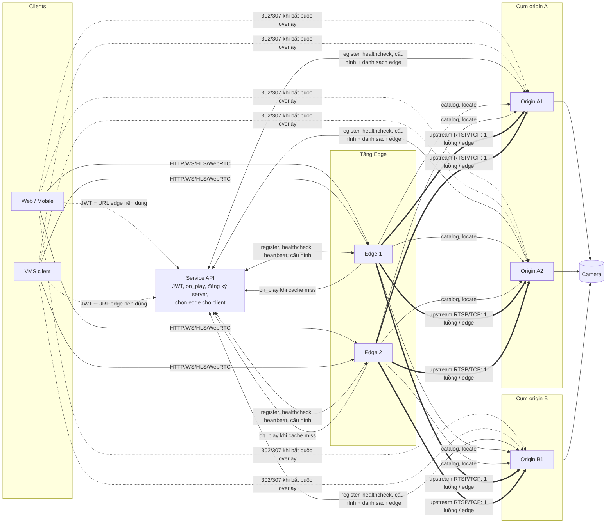
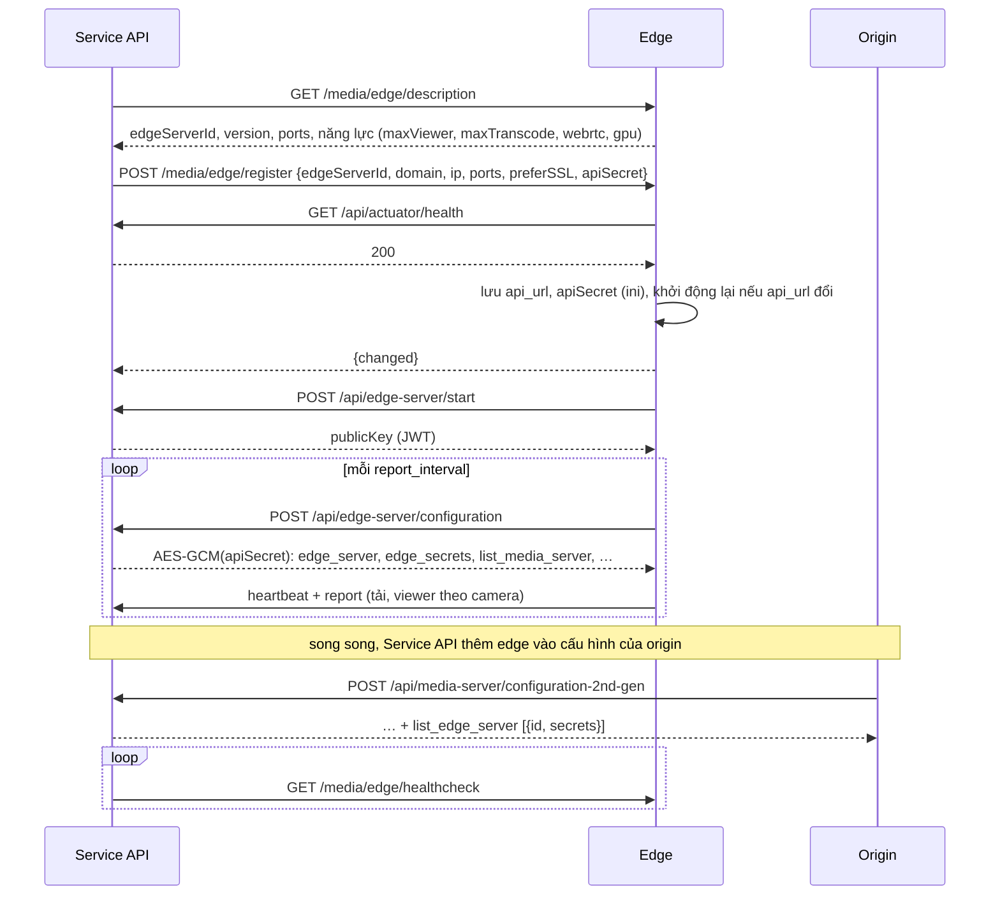
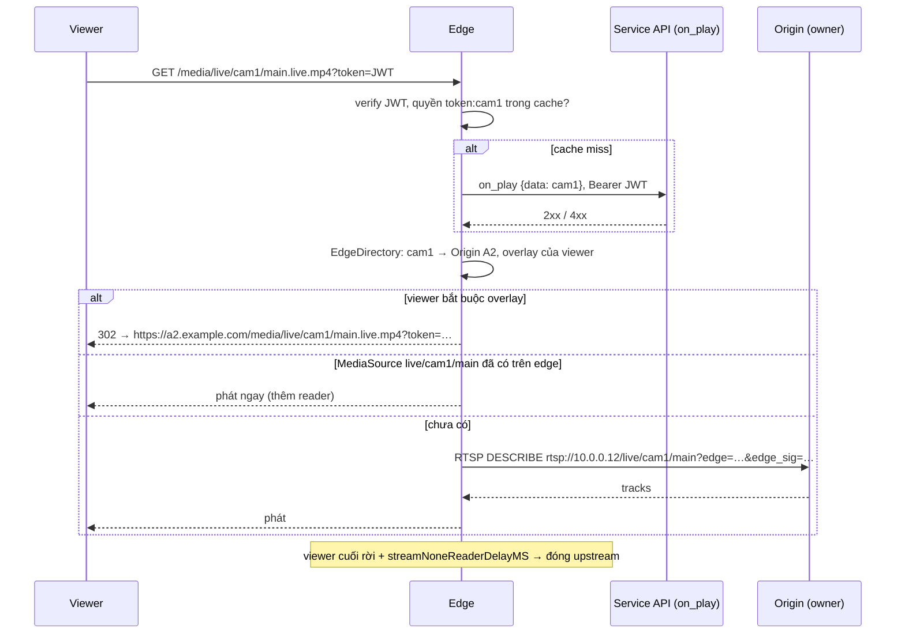
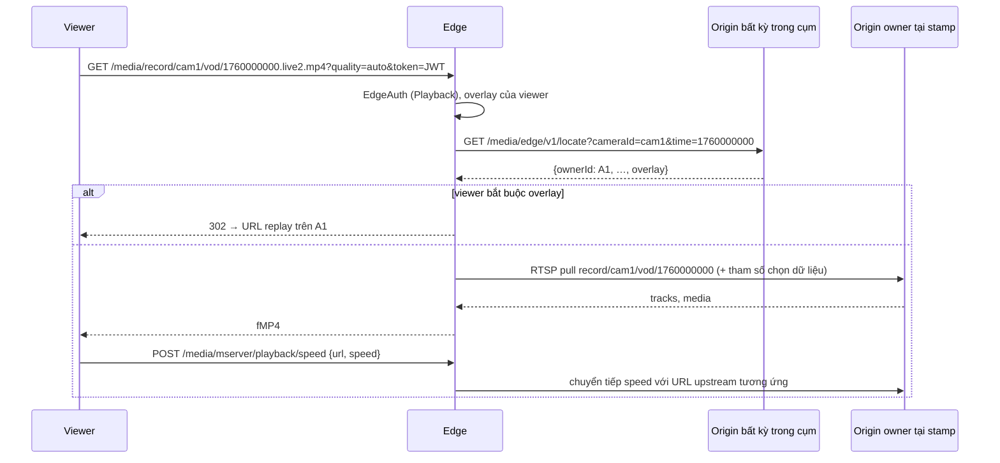
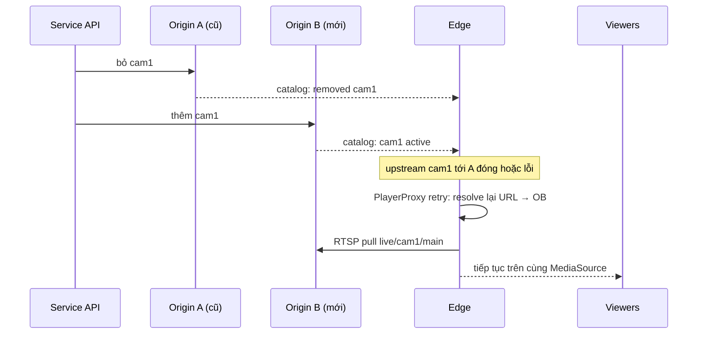

# Edge Media Server — phân tích yêu cầu và thiết kế hệ thống

Trạng thái: **bản thiết kế đã chốt hướng, chưa triển khai** (cập nhật 2026-10-11). Tài liệu này mô tả
yêu cầu, kiến trúc, giao tiếp với MediaServer và Service API, và kế hoạch theo giai đoạn. Các quyết
định đã chốt và việc còn phải phối hợp nằm ở mục 15.

Thuật ngữ:

| Từ | Nghĩa |
|---|---|
| **Origin** | MediaServer hiện tại (`server/main.cpp`): kéo camera, ghi hình, tier, overlay privacy |
| **Edge** | Service mới trong tài liệu này, chỉ phân phối luồng cho người xem |
| **Service API** | Backend quản lý hiện tại: phân phối camera cho origin, cấp JWT, hook `on_play` |
| **Cụm origin** | Các origin cùng `serverGroupId`, đồng bộ ESC với nhau qua `SyncManager` |
| **Upstream** | Kết nối edge → origin để lấy một luồng |
| **Viewer** | Client xem (web, mobile, VMS client) |

---

## 1. Bối cảnh và vấn đề

Origin hiện làm mọi việc trong cùng một tiến trình: kéo camera, ghi hình 24/7, tier NAS/S3, motion,
overlay privacy, transcode và phục vụ người xem. Số người xem một origin chịu được bị giới hạn bởi tài
nguyên dùng chung với phần ghi hình (`docs/live500-perf-test.md`, `docs/ccu-capacity-test-design.md`):
CPU/băng thông cho TLS + mux mỗi viewer, transcode reduce-quality, mỗi phiên replay đọc đĩa riêng.
`GlobalMonitor::isReaderResourceLimit()` / `isReaderCountLimit()` trả `ResourceUnavailable` /
`MaxRequest` khi chạm ngưỡng — tức khi đông người xem, chính node đang ghi hình bị dồn tải.

Mục tiêu là tách phần **phân phối** ra một tầng giống CDN: mỗi luồng chỉ kéo từ origin **một lần cho
mỗi edge**, edge nhân bản cho số lượng lớn viewer, origin giữ tài nguyên cho ghi hình.

## 2. Yêu cầu

### 2.1. Yêu cầu chức năng

| ID | Yêu cầu | Ghi chú |
|---|---|---|
| F1 | Xem trực tiếp: HTTP-FMP4, WS-FMP4, HLS (TS và fMP4), HTTP-FLV/TS, **WebRTC** (`/index/api/webrtc?type=play`, WHEP) | Cùng URL với origin (`/media/live/...`) để FE chỉ đổi `BASE_URL`. **RTSP và RTMP bị từ chối** |
| F2 | Xem trực tiếp tự chọn chất lượng `.live2.mp4?quality=auto&prefered=hi` | Edge tự chọn Main/Sub theo luồng đang có |
| F3 | Xem lại: `/media/record/{cam}[/{stream}]/vod/{stamp}.live[2].mp4`, WS, HLS VOD, WebRTC | Kèm điều khiển tốc độ `/media/mserver/playback/speed` |
| F4 | Luồng transcode reduce-quality (`transcode=true&target_*`) **không overlay privacy**, chạy trên tài nguyên edge | Một transcode dùng chung cho mọi viewer cùng tham số |
| F5 | Xác thực JWT + kiểm tra quyền camera có **cache** | Cùng semantics với `UserAuthorManager` (mục 7) |
| F6 | Thu hồi phiên khi JWT hết hạn hoặc backend từ chối gia hạn | Giống `docs/user-author-manager-flow.md` |
| F7 | Biết camera đang chạy trên origin nào; tự chuyển upstream khi camera move/failover | Mục 6 |
| F8 | Một edge phục vụ **nhiều origin** và nhiều cụm origin | |
| F9 | **Không phát** cho viewer bắt buộc overlay privacy; chuyển (forward) viewer đó về origin | Mục 9 |
| F10 | Báo cáo: số viewer theo camera, flow report, audit | Gửi hook Service API |
| F11 | **Đăng ký và healthcheck edge với Service API** giống MediaServer: description, register, healthcheck, start, heartbeat, tải cấu hình | Mục 4 |

### 2.2. Yêu cầu phi chức năng

| ID | Yêu cầu |
|---|---|
| N1 | Triển khai độc lập trên máy khác, không cần SQLite/ESC, không cần đĩa ghi hình. **Stateless** — khởi động lại chỉ mất cache; cấu hình lấy lại từ Service API |
| N2 | Mở rộng ngang: tải lên origin tỉ lệ với **số edge × số luồng đang xem**, không tỉ lệ với số viewer |
| N3 | Kế thừa codebase: dùng lại `toolkit`, `mediakit` (`src/`, `ext-codec/`, `webrtc/`), phần auth của `managerkit`; thay đổi phía origin nhỏ và có cờ bật/tắt |
| N4 | C++11, cùng quy tắc threading của repo: không blocking poller, không capture `this` |
| N5 | TTFF live qua edge ≤ TTFF trực tiếp + 1 s khi luồng đã có trên edge; ≤ +2 s khi phải mở upstream |
| N6 | Origin hoặc một edge chết không làm mất phiên ở chỗ khác; viewer kết nối lại được trong vài giây |
| N7 | Không log JWT, secret, chữ ký, URL có `token` |

### 2.3. Ngoài phạm vi

- **RTSP, RTMP cho viewer**: edge không mở cổng RTSP/RTMP phục vụ người xem. Client cần các giao thức
  này kết nối thẳng origin. (Edge vẫn dùng RTSP làm kênh upstream nội bộ tới origin.)
- **Overlay privacy trên edge**: edge không render và không relay luồng đã overlay. Viewer cần overlay
  được chuyển về origin (mục 9).
- Đọc trực tiếp bản ghi từ đĩa/NAS/S3: replay luôn đi qua origin, phần đọc đĩa vẫn ở origin. Đã chấp
  nhận, chưa có giải pháp.
- Điều khiển camera (PTZ, cấu hình), backchannel/talk, motion MJPEG, API quản trị camera.
- Ghi hình, tier, motion trên edge.

## 3. Tổng quan kiến trúc



Edge gồm sáu khối:

| Khối | Trách nhiệm |
|---|---|
| **EdgeRegistry** | Đăng ký, healthcheck, heartbeat, tải cấu hình từ Service API (secret, danh sách origin, public key JWT) |
| **EdgeDirectory** | Camera/luồng nào đang ở origin nào (catalog), tra owner replay theo thời điểm |
| **EdgeAuth** | Verify JWT, cache quyền `token:device`, gọi `on_play`, gia hạn, thu hồi |
| **UpstreamManager** | Mở/đóng upstream theo nhu cầu, đổi origin khi camera move, gom viewer cùng luồng |
| **Delivery** | `MultiMediaSourceMuxer` + session HTTP/WS/HLS + WebRTC có sẵn của `mediakit` |
| **TranscodeService** | `TranscodeProcessor` + `HwCodecManager` trên luồng đã có ở edge |

Nguồn sự thật: **Service API** cho danh sách server, secret, quyền người dùng và việc chọn edge;
**origin** cho vị trí camera đang chạy và chính sách overlay/reduce-quality. Edge chỉ cache.

## 4. Đăng ký và healthcheck edge

Edge đi đúng vòng đời mà origin đang dùng với Service API, chỉ khác prefix và payload. Đối chiếu:

| Bước | Origin hiện tại | Edge |
|---|---|---|
| Service API thăm dò server | `GET /media/mserver/description` | `GET /media/edge/description` |
| Service API đăng ký server | `POST /media/mserver/register` (`mediaServerId`, domain/ip/port Service API, `preferSSL`, `apiSecret`, cert) | `POST /media/edge/register` (`edgeServerId`, cùng các trường) |
| Server kiểm Service API trước khi nhận | hook `on_server_health_check` (`/api/actuator/health`) | giống hệt |
| Service API kiểm server còn sống | `GET /media/mserver/healthcheck` | `GET /media/edge/healthcheck` (kèm tải, mục 4.3) |
| Service API yêu cầu tải lại cấu hình ngay | `POST /media/mserver/incur` | `POST /media/edge/incur` |
| Server báo đã khởi động, nhận `publicKey` | `on_server_started` (`/api/media-server/start`) | `/api/edge-server/start` |
| Heartbeat | `on_server_keepalive` (`/api/media-server/heartbeat`) | `/api/edge-server/heartbeat` |
| Tải cấu hình (mã hoá AES-GCM bằng `apiSecret`) | `on_server_load2` (`/api/media-server/configuration-2nd-gen`) | `/api/edge-server/configuration` |
| Báo thống kê | `on_server_report2` (`channels:update`) | `/api/edge-server/report` |

Phía edge dùng lại nguyên code: `registerConfigurationApis()` (`server/WebApiConfig.cpp`),
`healthCheckServiceFromOrigin()`, `decryptServerConfigJson()`, `reportServerStatistic()`,
`loadServerStartedConfigJson()` (`server/WebHook.cpp`, `server/Manager.cpp`) — tách các hàm này ra
chỗ dùng chung, tham số hoá prefix/hook, **không chép**.

### 4.1. Trình tự



Bảo vệ API đăng ký giống origin (cùng cơ chế xác thực `/media/mserver/register` đang dùng). Edge chưa
đăng ký hoặc chưa tải được cấu hình lần đầu thì **không phục vụ viewer** (`503`).

### 4.2. Cấu hình edge nhận từ Service API

Response `/api/edge-server/configuration` (sau giải mã):

```json
{
  "edge_server": {
    "id": "edge-01",
    "publicDomain": "edge01.example.com",
    "httpPort": 80, "httpsPort": 443,
    "natHttpPort": 0, "natHttpsPort": 0,
    "rtcExternIP": "203.0.113.10",
    "maxViewer": 3000, "maxTranscode": 8
  },
  "edge_secrets": [
    { "kid": "k2", "secret": "…", "notBefore": 1760150000 },
    { "kid": "k1", "secret": "…", "notAfter": 1760160000 }
  ],
  "list_media_server": [
    { "id": "A1", "ip": "10.0.0.11", "domain": "a1.example.com", "rtsp_port": 554, "http_port": 80,
      "https_port": 443, "serverGroupId": 3, "clientUseSsl": true, "useDomain": true }
  ],
  "prewarm": ["cam-lobby-01"]
}
```

- `list_media_server` cùng định dạng `MediaServerInfo` (`manager/Server/ClusterManager.h`) mà origin đã
  nhận, nên dùng lại parser. Đây là **danh sách origin** của edge — không cần cấu hình seed tay.
  Edge dùng địa chỉ nội bộ (`ip`, `rtsp_port`) cho upstream/catalog, và địa chỉ public (`domain`,
  cổng NAT, `clientUseSsl`) để dựng URL forward cho viewer (mục 9).
- `edge_secrets` mục 7.3.

### 4.3. Healthcheck và tải

`GET /media/edge/healthcheck` trả `edgeServerId` và trạng thái để Service API chọn edge cho client:

```json
{ "code": 0, "data": {
  "edgeServerId": "edge-01", "ready": true,
  "viewers": 1840, "upstreams": 212, "transcodes": 5,
  "cpu": 0.61, "netOutMbps": 2380, "netOutCapacityMbps": 10000,
  "originsReachable": 6, "originsTotal": 6
} }
```

`ready=false` khi: chưa có cấu hình, không còn origin nào liên lạc được, hoặc vượt ngưỡng tài nguyên.
Heartbeat gửi cùng nội dung + danh sách camera đang có upstream trên edge, để Service API ưu tiên
đưa viewer của camera đó về edge đang giữ sẵn luồng.

## 5. Luồng chính

### 5.1. Xem trực tiếp (HTTP/WS/HLS)



- Upstream mở theo nhu cầu, giống `pullStreamFromOrigin()` có sẵn trong `server/WebHook.cpp`
  (nghe `kBroadcastNotFoundStream` → `addStreamProxy`), nhưng URL lấy từ EdgeDirectory thay vì
  `cluster.origin_url` cố định.
- Upstream mặc định **RTSP over TCP** (nội bộ): giữ nguyên codec H264/H265/AAC/G711, overhead thấp.
- `.live2.mp4?quality=auto`: edge kéo Main hoặc Sub theo `prefered`, chuyển sang luồng kia khi luồng
  ưu tiên mất. Dùng lại phần chọn luồng `live2` của origin, chỉ khác nguồn là upstream trên edge.
- Edge tắt RTSP/RTMP server (`rtsp.port=0`, `rtmp.port=0`, không cài listener) — không cần từ chối
  từng request.

### 5.2. WebRTC

- Signaling `/index/api/webrtc?type=play` và WHEP `/index/api/whep`, có `token` trong URL. Bật
  `ENABLE_WEBRTC` + `ENABLE_RTPPROXY` cho target edge (thiếu `ENABLE_RTPPROXY` thì build hỏng,
  xem `docs/user-author-manager-flow.md` mục 4).
- Nguồn RTC là MediaSource upstream trên edge, dùng chung với HTTP/HLS: thêm viewer WebRTC không mở
  thêm upstream.
- Xác thực: `play_plugin` phát `kBroadcastMediaPlayed` như HTTP; đăng ký phiên được chuyển sang
  `WebRtcTransportImp` (`kBroadcastMediaSessionTransfer`) để thu hồi được. Checklist kiểm thật ở
  `docs/user-author-manager-flow.md` mục 4 (hook chậm, hook từ chối, JWT hết hạn) là điều kiện đạt.
- Signaling room/P2P (`WebRtcSignalingPeer`) **không bật** trên edge: đường này chưa được bảo vệ
  quyền và đang cast sai kiểu sender (ghi ở cùng tài liệu).
- Mạng: `rtc.externIP` lấy từ cấu hình Service API (`edge_server.rtcExternIP`), mở dải UDP
  `rtc.port_range`; TURN tích hợp (`rtc.enableTurn`) cho client sau NAT chặt.
- Codec: trình duyệt cần H264 (H265 chỉ một số trình duyệt). Camera H265 → client yêu cầu
  `transcode=true&target_vcodec=h264`, edge transcode (mục 5.4). Audio AAC không đi qua WebRTC
  trình duyệt; G711 đi được. Chuyển AAC → Opus chưa có trong codebase — đợt đầu phát video-only khi
  audio là AAC (mục 15).
- Viewer WebRTC bắt buộc overlay: trả `307` cho request signaling (giữ method POST + body SDP) về
  endpoint tương ứng của origin (mục 9).

### 5.3. Xem lại

Replay ở origin là `MediaSource` tạo theo yêu cầu qua `MediaSource::createFromMP4ByApp`
(`src/Common/MediaSource.cpp`) cho **mọi schema**, nên edge kéo được bằng RTSP:

```text
rtsp://{origin}/record/{cam}/{stream}/vod/{stamp}?quality=…&prefered=…&duration=…&edge=…&edge_sig=…
```



- Một phiên replay ≈ một upstream (trùng `stamp` + tham số thì dùng chung). Lợi ích ở replay là chuyển
  TLS, mux, HLS VOD, WebRTC, transcode và xác thực sang edge; đọc đĩa vẫn ở origin (đã chấp nhận).
- Owner theo thời gian dùng logic `SearchEngine` hiện có (resolve owner trên `VmsResourceAssignment`),
  nên **locate hỏi origin bất kỳ trong cụm** được.
- Replay qua nhiều owner: đợt đầu chỉ phát trong owner chứa `stamp`; viewer seek thì mở URL mới.
- API metadata `recordedTimePeriod`, `recordedThumnail`: edge **reverse-proxy** tới origin của cụm sau
  khi xác thực, cache ngắn cho thumbnail (khoá `cam + stream + pos`, TTL 60 s như origin).

### 5.4. Transcode reduce-quality (không overlay)

- `transcode=true&target_*` trên edge tạo derived source từ upstream **trên edge**, dùng lại
  `parseTranscodeRequest()` / `TranscodeProcessor` và `HwCodecManager` (GPU nếu có).
- Khoá dùng chung `stream + md5(tham số)`, quy ước `<stream>.transcode.<md5>` như origin nhưng
  **không có tag policy**.
- Quyền reduce-quality (`enableReduceQualityOnView`, profile cho phép) lấy từ catalog. Camera tắt
  reduce-quality → `TranscodeDisabled` như origin.
- Chỉ phục vụ viewer **không** bắt buộc overlay; viewer bắt buộc overlay đã được forward trước bước này.
- Giới hạn `edge_server.maxTranscode` và ngưỡng CPU/GPU → `503`.

## 6. EdgeDirectory — camera đang ở origin nào

### 6.1. Phương án

| Phương án | Ưu | Nhược | Kết luận |
|---|---|---|---|
| A. Hỏi Service API | Đúng nguồn phân phối | Không biết camera đã thật sự lên chưa; không có lịch sử owner cho replay | Chỉ dùng cho danh sách origin (mục 4.2) |
| B. Edge làm peer đọc của `SyncManager` | Có sẵn assignment, status | Snapshot nặng; ack cursor ảnh hưởng prune log; kéo SQLite/ESC vào edge, trái N1 | Không chọn |
| C. **API catalog trên origin** + locate khi miss | Nhẹ, origin báo đúng cái đang chạy; edge stateless | Thêm API ở origin | **Chọn** |

### 6.2. Catalog

Mỗi origin báo các camera/luồng **nó đang chạy**, có version tăng dần:

```text
GET /media/edge/v1/catalog?since={version}&wait=25      (long-poll, header ký edge)
```

```json
{
  "code": 0,
  "data": {
    "serverId": "A2",
    "serverGroupId": 3,
    "epoch": "8f1c…",
    "version": 1842,
    "full": false,
    "cameras": [
      {
        "cameraId": "cam1",
        "active": true,
        "assignedAt": 1760100000,
        "streams": [
          { "streamId": "main", "online": true, "codec": "H265", "width": 1920, "height": 1080 },
          { "streamId": "sub",  "online": true, "codec": "H264", "width": 640,  "height": 360 }
        ],
        "overlay": {
          "required": true,
          "watermark": true, "watermarkExcludedRoles": ["admin"],
          "privacyMask": true, "maskExcludedRoles": ["admin"],
          "version": 7
        },
        "reduceQuality": { "enabled": true, "profiles": [ { "source": "main", "width": 960, "height": 540, "fps": 10 } ] }
      }
    ],
    "removed": ["cam9"]
  }
}
```

- `epoch` đổi khi origin khởi động lại → edge lấy lại `full`.
- Dữ liệu phía origin: `CameraManager` + `CameraStatistic` (như listener `kBroadcastMediaViewOverlay`
  trong `server/Manager.cpp`); version tăng khi có `kBroadcastDeviceChanged`, `kBroadcastMediaChanged`,
  đổi `CameraOption` overlay/reduce-quality, assign/release camera.
- Long-poll để thay đổi tới edge < 1 s mà origin không cần biết địa chỉ edge.
- Hai origin cùng báo `active` một camera (đang move): chọn bản có `assignedAt` mới hơn.
- Origin mất kết nối > `edge.catalogStaleSec` (30 s): camera của nó đánh dấu **stale**; upstream đang
  chạy vẫn giữ. Viewer mới của camera stale: không biết chắc chính sách overlay → **forward về origin**
  nếu origin còn địa chỉ, không thì `503`.

### 6.3. Locate khi miss và cho replay

```text
GET /media/edge/v1/locate?cameraId=cam1[&time=1760000000]
→ { "ownerId": "A1", "assignedAt": …, "releasedAt": …, "overlay": {...}, "reduceQuality": {...} }
```

- Không có `time`: owner hiện tại (`findLastAssignment`). Có `time`: owner tại thời điểm
  (`findAssignmentsOverlappingRange`) — dùng lại resolve owner của `SearchEngine`.
- Hỏi origin bất kỳ của cụm (assignment đồng bộ qua ESC). Cache `cameraId + time-bucket` 60 s.
- Camera không có trong catalog nào → locate song song một origin mỗi cụm (giới hạn đồng thời), kết
  quả âm cache 10 s.
- Camera đã chuyển đi nhưng origin cũ còn bản ghi: `overlay` trả theo cấu hình hiện tại (lấy từ
  `StatisticRecorder` như origin đang làm cho replay camera offline).

### 6.4. Camera move / failover



- `PlayerProxy` hiện retry với URL cố định; cần hook **resolve URL trước mỗi lần retry**.
- Codec đổi sau failover: đóng viewer để client kết nối lại (đã chấp nhận).
- Giữ MediaSource tối đa `edge.upstreamGraceSec` (15 s) chờ origin mới, sau đó đóng viewer.

## 7. Xác thực và cache xác thực

### 7.1. Viewer → edge

Giữ hợp đồng của origin để FE không đổi gì ngoài `BASE_URL`:

- JWT qua `Authorization: Bearer` hoặc `?token=`; HLS dùng `session_id` + cookie như origin.
- Verify JWT **tại edge** bằng `auth.jwtPublicKey` — nhận từ Service API ở bước start (mục 4.1), như
  origin (`loadServerStartedConfigJson`).
- Quyền camera: cache `token:device → {permit, expiresAt}`, TTL `min(now + 600 s, jwt.exp)`; miss thì
  gọi `on_play` với body `{data: device_id}` + `Authorization: Bearer <JWT>` — **đúng request origin
  đang gửi**, Service API không cần sửa.
- Gom request: mỗi cặp `token:device` tối đa một lần gọi hook đang chạy (`_token_checks`).
- Cache âm (hook 4xx): 30 s.
- Gia hạn, thu hồi, đóng phiên theo `docs/user-author-manager-flow.md` mục 3–4. JWT không được gia hạn.

Tái sử dụng `UserAuthorManager` + `UserSessionCache` (`manager/User/`). Chỗ duy nhất chạm SQLite là
`UserSessionCache::saveUserSession()`; trên edge tắt bằng `auth.persistUserSession=0`, không kéo
`DbStorage` vào edge.

Cache trong bộ nhớ từng edge. Chưa dùng cache chung (Redis); theo dõi tải `on_play` ở E5, nếu cần
thì thêm cache chung hoặc "media ticket" ký sẵn (mục 15).

### 7.2. Edge → origin

Origin phải tin edge để **không gọi `on_play` cho upstream** và **phát luồng gốc** cho edge.

- URL upstream và API `/media/edge/v1/*` mang chữ ký HMAC-SHA256, hết hạn ngắn:

  ```text
  edge={edgeId}&edge_kid={kid}&edge_ts={unix}&edge_sig=HMAC(secret[kid], edgeId|app|stream|edge_ts)
  ```

  API dùng header `X-Edge-Id`, `X-Edge-Kid`, `X-Edge-Ts`, `X-Edge-Sig` (ký `method|path|query|ts`).
  Ký cả `app/stream` để chữ ký lộ ra không dùng được cho camera khác; lệch `edge_ts` > 300 s → từ chối.
- Origin, trong listener `kBroadcastMediaPlayed`: chữ ký hợp lệ → bỏ qua `on_play` và policy overlay
  theo JWT, phát luồng gốc, tính reader vào nhóm `edge` (vẫn áp `isReaderResourceLimit` để tự bảo
  vệ). Không hợp lệ → xử lý như request thường.
- Chỉ phục vụ luồng gốc và luồng replay; edge không yêu cầu luồng overlay.
- Kênh edge ↔ origin nên là mạng nội bộ; qua mạng công cộng thì dùng RTSPS/HTTPS.

### 7.3. Secret edge — Service API cấp

Secret edge là khoá đối xứng giữa **một edge** và các origin, chỉ dùng để ký, không gửi qua mạng
ngoài kênh cấu hình đã mã hoá. Lộ secret = kéo được luồng gốc mọi camera trên các origin tin edge đó.

| Khoá | Ai giữ | Dùng cho |
|---|---|---|
| JWT | Viewer | Viewer → edge, viewer → origin |
| `manager.apiSecret` | Service API + một server | Mã hoá cấu hình, gọi API quản trị server |
| **Secret edge** (`kid`) | Service API, một edge, các origin | Edge → origin |

- **Cấp**: Service API sinh secret ngẫu nhiên ≥ 32 byte cho mỗi edge khi edge được thêm.
- **Phân phối**: edge nhận `edge_secrets` trong `/api/edge-server/configuration`; origin nhận
  `list_edge_server: [{id, secrets: [{kid, secret, notBefore, notAfter}]}]` trong
  `configuration-2nd-gen`. Cả hai response đã mã hoá AES-GCM bằng `apiSecret` của từng server
  (`decryptServerConfigJson`). Secret chỉ giữ trong bộ nhớ, không ghi ini, không log.
- **Xoay vòng**: Service API thêm `kid` mới cho origin trước, đợi một chu kỳ cấu hình (hoặc gọi
  `incur`), rồi mới đưa `kid` mới cho edge; origin chấp nhận mọi `kid` còn hạn; `kid` cũ gỡ sau
  `notAfter`. Edge luôn ký bằng `kid` mới nhất đã có hiệu lực.
- **Thu hồi edge**: Service API gỡ edge khỏi `list_edge_server` và gọi `/media/mserver/incur` trên
  các origin để áp ngay; origin đóng các upstream đang mở của edge đó.

## 8. Upstream và fan-out

- Một upstream cho mỗi `(origin, app, stream, tham số replay)` trên mỗi edge. Mọi viewer của luồng đó
  dùng chung `MediaSource` + `MultiMediaSourceMuxer` của edge; mọi giao thức đầu ra sinh từ đó.
- Mở theo nhu cầu, đóng sau `general.streamNoneReaderDelayMS` khi hết viewer (edge nên 30–60 s).
- **Prewarm**: danh sách camera từ cấu hình Service API (`prewarm`) luôn giữ upstream.
- Bảo vệ origin: `edge.maxUpstreamPerOrigin`, mở upstream mới qua hàng đợi + jitter
  (`edge.maxConcurrentUpstreamOpen`).
- Phân cấp edge cấp 2 cho camera rất nóng: để sau E5.

**Chọn edge cho viewer** do Service API đảm nhiệm: dựa vào healthcheck/heartbeat (mục 4.3) và danh
sách camera đang có upstream trên từng edge. Gợi ý: consistent hashing trên `cameraId` trong tập edge
`ready`, tràn sang edge kế tiếp khi quá tải — để viewer cùng camera rơi vào cùng edge.

## 9. Viewer bắt buộc overlay privacy — forward về origin

Edge tính chính sách overlay cho viewer bằng cùng quy tắc với origin (`OverlayPrivacyUtils`, claim
`overlay` và role trong JWT, khối `overlay` trong catalog/locate):

| Kết quả | Edge xử lý |
|---|---|
| Camera không có overlay, hoặc viewer được miễn **cả** watermark và privacy mask | Phát từ upstream luồng gốc trên edge |
| Viewer cần ít nhất một thành phần overlay | **Forward về origin**, edge không phát |
| Không xác định được (catalog stale, thiếu khối `overlay`, lỗi tính policy) | Forward về origin (origin là nơi quyết định); không có địa chỉ origin thì `503` |

Cách forward theo giao thức:

| Giao thức | Forward |
|---|---|
| HTTP-FMP4/FLV/TS, HLS playlist (live, replay) | `302 Location` tới cùng path + query trên origin owner |
| WS-FMP4 | Từ chối upgrade bằng `302` tới URL `ws(s)` của origin (client WebSocket trình duyệt không tự theo redirect — FE phải đọc header `X-Origin-Url` / mã lỗi và tự mở lại, mục 15) |
| WebRTC signaling (`webrtc?type=play`, WHEP) | `307` giữ POST + SDP tới endpoint origin |
| Transcode reduce-quality kèm overlay | Forward như trên, origin gộp overlay + reduce-quality trong một derived transcode như hiện nay |

- URL đích dựng từ địa chỉ public của origin trong `list_media_server` (`domain` hoặc `ip`, cổng NAT,
  `clientUseSsl`, `customPath` — cùng quy tắc FE đang dùng). Query giữ nguyên, kể cả `token` và
  `session_id`; origin tự xác thực lại như request trực tiếp.
- Edge **không bao giờ** cấp chữ ký edge cho viewer, nên viewer forward chỉ có quyền của JWT của mình.
- `overlay.version` đổi trong catalog → edge đóng các viewer của camera đó (HTTP/WS đóng kết nối,
  HLS xoá cookie, WebRTC `safeShutdown`) để viewer mở lại và được phân loại theo chính sách mới.
- Viewer HLS đã được redirect thì playlist con và segment đều ở origin; edge không còn liên quan.

## 10. Thay đổi cần làm ở origin

Sau cờ `edge.enable` (mặc định 0):

| # | Thay đổi | Vị trí dự kiến |
|---|---|---|
| O1 | Nhận `list_edge_server` trong `configuration-2nd-gen`, giữ bảng `edgeId → [kid, secret, hạn]` trong bộ nhớ; `incur` áp ngay; edge bị gỡ → đóng upstream của edge | `server/Manager.cpp` (`loadServerConfigJson`) |
| O2 | Kiểm chữ ký edge trong `kBroadcastMediaPlayed` trước nhánh JWT; hợp lệ → bỏ `on_play`, bỏ overlay, phát luồng gốc | `server/WebHook.cpp`, listener overlay `server/Manager.cpp` |
| O3 | Bộ đếm reader nhóm edge (viewer thật nằm ở edge) | `manager/Server/GlobalMonitor`, `ReaderMonitor` |
| O4 | `GET /media/edge/v1/catalog` (long-poll, version, epoch) | `server/WebApiEdge.cpp` mới, đăng ký trong `installWebApi()` |
| O5 | `GET /media/edge/v1/locate` dùng resolve owner của `SearchEngine` | cùng file |

Không cần migration: không có bảng mới, catalog dựng từ bộ nhớ của `CameraManager`.

## 11. Thay đổi cần làm ở Service API (team backend)

| # | Việc |
|---|---|
| S1 | Quản lý danh sách edge server: thêm/sửa/xoá, gọi `description` + `register` như với media server |
| S2 | Endpoint `/api/edge-server/start` (trả `publicKey`), `heartbeat`, `configuration` (mã hoá bằng `apiSecret`), `report` |
| S3 | Sinh, lưu, xoay vòng, thu hồi secret edge (mục 7.3); thêm `list_edge_server` vào `configuration-2nd-gen` của origin |
| S4 | Healthcheck định kỳ `/media/edge/healthcheck`; cơ chế cho client biết nên kết nối edge nào |
| S5 | Số viewer thật: lấy từ report/heartbeat của edge (origin chỉ thấy một reader mỗi edge) |
| S6 | `on_play` giữ nguyên hợp đồng; theo dõi tải khi số edge tăng |

## 12. Cấu trúc code của edge

```text
edge/
  CMakeLists.txt          target EdgeServer, bật bằng -DENABLE_EDGE_SERVER=ON
  main.cpp                vòng đời tiến trình, đọc config, cài listener (theo mẫu server/main.cpp)
  EdgeConfig.cpp/.h       onceToken + mINI cho [edge]
  EdgeRegistry.cpp/.h     description/register/healthcheck/incur, start/heartbeat/configuration/report
  EdgeDirectory.cpp/.h    catalog long-poll mỗi origin, locate, bảng camera → origin
  EdgeOriginClient.cpp/.h HTTP async tới origin (toolkit HttpRequester), ký HMAC
  EdgeUpstream.cpp/.h     PlayerProxy có resolver URL mỗi lần retry, hàng đợi mở upstream
  EdgeHooks.cpp/.h        listener MediaPlayed / NotFoundStream / StreamNoneReader / FlowReport, forward overlay
  EdgeWebApi.cpp/.h       playback/speed, reverse-proxy timeline/thumbnail
```

- Liên kết `toolkit`, `mediakit` (`src/`, `ext-codec/`, `webrtc/`), `manager/User/*`,
  `manager/Common/BlockingExecutors`, `manager/Server/ClusterManager` (chỉ `MediaServerInfo`).
  **Không** liên kết `manager/Camera`, `manager/Local`, `manager/Storage` (SQLite), `SyncManager`.
  Việc đầu tiên của E1 là kiểm danh sách phụ thuộc thực tế của các phần này.
- Phần dùng chung origin/edge (register/healthcheck, giải mã cấu hình, chọn luồng `live2`, overlay
  policy, parse transcode, ký/kiểm HMAC) đặt ở chỗ dùng chung và gọi từ cả hai, **không chép code**.
- `api/` (C ABI) không đổi.

### Threading

| Việc | Chạy ở |
|---|---|
| Session viewer, WebRTC transport, upstream `PlayerProxy`, muxer | Poller của `EventPollerPool`, mỗi MediaSource một poller |
| Catalog long-poll, locate, `on_play`, register/heartbeat/configuration, reverse-proxy | HTTP async của `toolkit`, không blocking |
| Ghi ini sau register | `BlockingExecutors::api()` như `/media/mserver/register` hiện tại |
| Verify JWT (RSA) | Ngoài lock như `getTokenCache()` hiện tại |
| Transcode | `TranscodeProcessor`; chờ process ffmpeg (nếu có) ở `BlockingExecutors::ffmpeg()` |

Callback capture `weak_ptr`; `EdgeRegistry`, `EdgeDirectory` là singleton.

## 13. Cấu hình edge

Phần lớn cấu hình đến từ Service API; ini chỉ giữ giá trị mặc định và tham số vận hành:

```ini
[general]
# Ghi bởi /media/edge/register
mediaServerId=edge-01
streamNoneReaderDelayMS=45000

[edge]
catalogWaitSec=25
catalogStaleSec=30
originForgetSec=600
maxUpstreamPerOrigin=200
maxConcurrentUpstreamOpen=16
upstreamGraceSec=15
negativeAuthCacheSec=30

[rtsp]
port=0
sslport=0

[rtmp]
port=0
sslport=0

[rtc]
# Ghi đè bởi edge_server.rtcExternIP
externIP=
port_range=49152-65535

[auth]
enableAuthorize=1
persistUserSession=0

[hook]
enable=1
# api_url, apiSecret ghi bởi register; đường dẫn hook riêng của edge
on_server_started=/api/edge-server/start
on_server_keepalive=/api/edge-server/heartbeat
on_server_load2=/api/edge-server/configuration
on_server_report2=/api/edge-server/report
on_server_health_check=/api/actuator/health
on_play=/api/camera/check-camera-of-user
```

## 14. Kế hoạch theo giai đoạn

| Giai đoạn | Nội dung | Điều kiện đạt |
|---|---|---|
| E0 | Origin: O1–O5 sau cờ `edge.enable`; chốt hợp đồng S1–S3 với team Service API | Unit: ký/kiểm HMAC nhiều `kid`, catalog version/epoch, locate theo thời điểm; build sync ON/OFF |
| E1 | Edge tối thiểu: target `EdgeServer`, EdgeRegistry, EdgeAuth, EdgeDirectory, live HTTP-FMP4/WS/HLS/FLV, **forward overlay** | Mock Service API + camera giả + 2 origin + 1 edge: register/healthcheck, xem live qua edge, viewer bắt buộc overlay luôn nhận redirect (kiểm bằng dải mã số frame: edge không gửi frame nào cho viewer đó), thu hồi JWT, move camera A→B |
| E2 | WebRTC (`webrtc?type=play`, WHEP), `307` cho viewer overlay | Checklist WebRTC của `docs/user-author-manager-flow.md` mục 4 đạt trên edge |
| E3 | Transcode reduce-quality trên edge (cả H265 → H264 cho WebRTC) | Một transcode cho N viewer cùng tham số; `TranscodeDisabled` đúng |
| E4 | Replay qua locate + RTSP pull, speed, proxy timeline/thumbnail | Replay qua ranh giới owner; tốc độ đổi được; viewer overlay forward đúng owner |
| E5 | Đo năng lực: `ccu_test.sh` trỏ vào edge, live500 với 1 origin + 2 edge; xoay vòng/thu hồi secret | Tải origin phẳng theo số viewer; TTFF đạt N5; thu hồi edge đóng upstream ngay |
| E6 | Edge cấp 2, cache quyền chung nếu E5 cho thấy `on_play` quá tải | Theo kết quả E5 |

## 15. Quyết định và việc còn lại

### Đã chốt (2026-10-11)

| # | Nội dung | Quyết định |
|---|---|---|
| D1 | Phạm vi transcode | Edge transcode reduce-quality, không overlay privacy |
| D2 | Chọn edge cho viewer | Service API dựng cơ chế cho client biết nên kết nối edge nào |
| D3 | Replay vẫn đọc đĩa ở origin | Chấp nhận; chưa có giải pháp |
| D4 | Secret edge | Service API cấp, phân phối qua kênh cấu hình đã mã hoá, xoay vòng theo `kid` (mục 7.3) |
| D5 | Đăng ký edge | Edge có register/healthcheck/start/heartbeat/configuration giống MediaServer (mục 4) |
| D6 | Giao thức phục vụ viewer | Từ chối RTSP, RTMP; cung cấp HTTP/WS/HLS và WebRTC |
| D7 | Viewer bắt buộc overlay | Edge không phát, forward về origin (mục 9) |
| D8 | Tải `on_play` | Cache trong bộ nhớ từng edge; đo ở E5, chỉ thêm cache chung khi cần |
| D9 | Đổi codec khi failover | Chấp nhận viewer bị ngắt một lần |
| D10 | Đếm viewer | Lấy từ edge (report/heartbeat); báo team API |

### Cần phối hợp / kiểm khi làm

1. Hợp đồng S1–S6 với team Service API (tên endpoint `/api/edge-server/*`, định dạng `edge_secrets`,
   `list_edge_server`) — các tên trong tài liệu là đề xuất.
2. WS-FMP4 forward: trình duyệt không tự theo redirect khi upgrade WebSocket; FE cần xử lý mã lỗi +
   `X-Origin-Url`, hoặc FE tự gọi origin khi biết trước viewer bắt buộc overlay (claim trong JWT).
3. WebRTC với audio AAC: đợt đầu video-only; nếu cần tiếng phải thêm chuyển AAC → Opus.
4. Báo FE: URL giữ nguyên, chỉ đổi `BASE_URL`; RTSP/RTMP vẫn phải dùng địa chỉ origin.
