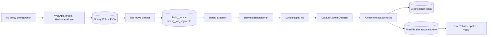
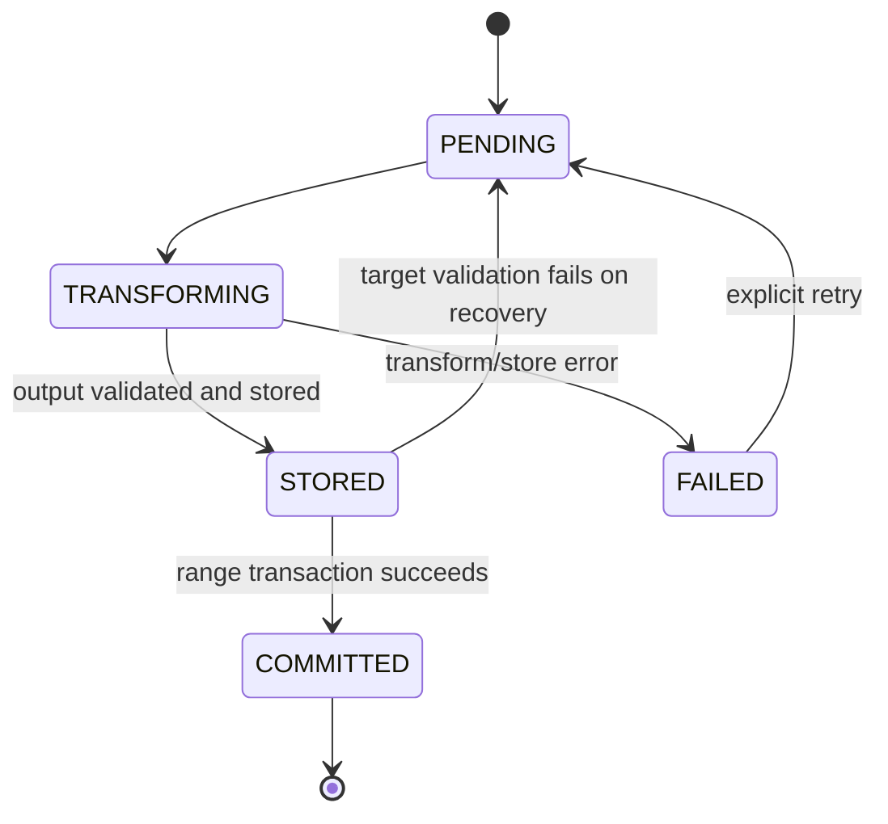

# Architecture Design: Giảm chất lượng khi chuyển dữ liệu giữa các tier

## Context

Tài liệu này cụ thể hóa [kế hoạch giảm chất lượng khi chuyển tier](tier-storage-quality-reduction-plan.md) trên kiến trúc hiện tại của S3MediaKit.

Mục tiêu là thêm một bước giảm độ phân giải, bitrate và FPS cho MP4 khi dữ liệu được chuyển sang tier đích, nhưng vẫn giữ các đặc tính quan trọng của hệ thống hiện tại:

- Quyết định move dựa trên storage policy và range bền vững.
- Source chỉ bị xóa sau khi target và metadata đã được xác nhận.
- Job có thể phục hồi sau khi process restart.
- Protected/evidence video vẫn move nhưng không bị giảm chất lượng.
- Tính năng mặc định tắt và không thay đổi hành vi của policy/job cũ.

## Current Architecture

### Thành phần hiện tại

| Thành phần | Trách nhiệm hiện tại |
|---|---|
| `TierStorageManager` | Lập lịch retention/pressure move, tạo và dispatch `TieringJob`, copy/upload segment, commit range, restore và reconciliation. |
| `PolicyTierConfig`, `PolicyAdvancedRules` | Model cấu hình policy; serialize trực tiếp vào JSON trong `StoragePolicy`. |
| `TieringJob`, `SegmentTierRange` | Job move bền vững và catalog range tổng hợp trong SQLite. |
| `TierFileStorageBase`, `TierObjectStorage` | I/O tới local/NAS và MinIO/S3. |
| `TimeFile`/`TimeRebuilder` | Catalog playback theo segment; hiện hỗ trợ giữ hoặc xóa block nhưng chưa hỗ trợ cập nhật `file_size`. |
| `WebApiStorage`/`TierStorageBase` | REST API, JSON mapping và validation policy/storage. |
| `BlockingExecutors` | Các thread pool blocking riêng cho API, device, discovery, storage maintenance và ffmpeg tương tác. |

### Luồng move hiện tại

```text
retention/pressure/external policy
  -> queueTierMoveJob(range, source tier, target tier, policy)
  -> tiering_jobs[PENDING]
  -> dispatchPendingTieringJobs()
  -> validate policy + pool health + claim RUNNING
  -> executeLocalTierMove() hoặc executeObjectStorageUpload()
  -> copy/upload từng source MP4 với cùng storage key
  -> commitTierTransfer(): đổi tier/pool của SegmentTierRange
  -> xóa source
  -> tiering_jobs[DONE]
```

Các đặc điểm cần giữ:

- `collectSegmentFilesForJob()` kiểm tra snapshot của range để ngăn job cũ ghi đè range đã thay đổi.
- Target hiện được rollback khi range commit thất bại.
- Missing source có retry/backoff và chỉ bị loại khi source pool được xác nhận đang online.
- `SegmentTierRange.size_bytes` và `TimeBlock.file_size` hiện cùng phản ánh kích thước file nguồn.
- Storage key không đổi khi move, nên playback dựa vào range/pool hiện tại để định tuyến.

### Khoảng trống kiến trúc

- Job transfer hiện vẫn chạy trên `WorkThreadPool` poller dù thực hiện disk, SQLite và S3 blocking.
- Không có abstraction file-to-file transform trong `managerkit`.
- `server/Process` không thể được dùng từ `managerkit` vì chiều phụ thuộc là `server -> ManagerKit`, không phải ngược lại; API của nó cũng nhận command string.
- Job chỉ có progress tổng, nên restart giữa một range sẽ làm lại các segment đã transcode.
- Transcoding làm thay đổi kích thước file nhưng TimeFile chưa có luồng patch kích thước an toàn.

## Requirements and Constraints

### Functional

- FE bật/tắt bằng master switch trong policy và profile riêng cho WARM/COLD.
- Profile gồm codec H.264/H.265, max width/height, max FPS và max video bitrate.
- Áp dụng cho retention, pressure và external move khi target pool ánh xạ tới tier có profile.
- Không upscale hoặc tăng FPS/bitrate.
- Audio AAC/MP3/Opus được stream-copy; audio khác (G.711) encode sang AAC 32k vì muxer mp4 không nhận G.711.
- Protected/evidence video move nguyên bản.
- Không backfill dữ liệu đã move trước khi bật tính năng.
- Transcode thất bại làm job thất bại/retry. Khi một range đã có 3 job thất bại vì `TIER_TRANSCODE_PROBE_FAILED`/`ENCODER_FAILED`/`INVALID_PROFILE`: trigger PRESSURE copy bản gốc (`COPY_MOVE`), trigger RETENTION lùi lại theo backoff của missing segment (`storage.tiering_missing_segment_retry_base_seconds`, tối đa 1 ngày).

### Technical

- C++11; không sử dụng API C++14 trở lên.
- Disk, SQLite, S3 và chờ tiến trình con không được chạy trên EventPoller.
- Không capture raw `this` trong callback bất đồng bộ.
- SQLite transaction có ghi phải dùng `beginWriteTxn()`.
- Không truyền dữ liệu FE vào shell hoặc command template.
- Phải giữ nguyên storage key, URL playback và cơ chế restore hiện tại.
- Cấu hình mới mặc định tắt và job cũ phải tiếp tục là copy move.

### Operational

- Encode tiêu thụ CPU/GPU lớn và kéo dài hơn copy thông thường.
- Storage maintenance, REST và snapshot không được bị starvation bởi tier transcoding.
- Node có thể khác nhau về binary ffmpeg và phần cứng NVIDIA/Intel.
- Không giả định throughput hoặc số encoder session cố định; concurrency phải cấu hình được.

## Design Options

### Option A: External ffmpeg trong durable tiering workflow

#### Description

Thêm `TierMediaTransformer` gọi `ffprobe`/`ffmpeg` qua một argv-based process runner. Mỗi segment có durable state trong SQLite. Output được validate rồi mới chuyển vào target backend và commit range.

#### Advantages

- Tận dụng mux/demux, NVENC, QSV và codec detection đã ổn định của ffmpeg.
- Không cần thêm `libavformat` và một file transcoding pipeline mới vào MediaKit.
- Cách ly tốt với live streaming pipeline.
- Dễ test bằng fake transformer và dễ quan sát command/result theo job.
- Durable segment state tránh encode lại toàn bộ range sau restart.

#### Disadvantages

- Có chi phí tiến trình con cho từng segment.
- Cần quản lý timeout, kill, staging và log.
- Capability phụ thuộc binary/runtime trên từng node.

#### Risks

- Hardware encoder có thể được liệt kê nhưng không hoạt động do driver/session limit.
- Crash giữa upload và DB update có thể để lại target có sẵn; workflow phải idempotent.

### Option B: Native libav pipeline trong ManagerKit

#### Description

Dùng trực tiếp libavformat/libavcodec/libavfilter để đọc MP4, decode, scale/fps, encode và remux trong process MediaServer.

#### Advantages

- Không tạo tiến trình con.
- Có thể chia sẻ buffer và kiểm soát progress chi tiết.
- Không cần parse output `ffprobe`.

#### Disadvantages

- Codebase hiện không link `libavformat` cho luồng này và live `TranscodeProcessor` không phải file-to-file pipeline.
- Tăng mạnh phạm vi memory/lifetime/error handling trong process chính.
- Hardware context của NVENC/QSV phức tạp và phụ thuộc phiên bản ffmpeg.
- Lỗi codec có thể ảnh hưởng trực tiếp MediaServer thay vì một child process.

#### Risks

- Regression lớn ở build matrix và platform.
- Khó đảm bảo cleanup đầy đủ cho mọi lỗi mux/decode/encode.

### Option C: Dịch vụ transcoding độc lập

#### Description

TierStorageManager gửi job và source URI tới một service ngoài; service ghi output vào target hoặc trả artifact để MediaServer commit.

#### Advantages

- Scale CPU/GPU độc lập với MediaServer.
- Cách ly crash và dependency ffmpeg hoàn toàn.
- Phù hợp nếu sau này có transcode farm dùng chung.

#### Disadvantages

- Thêm service discovery, authentication, upload protocol, distributed job state và vận hành.
- Source local/NAS phải được chia sẻ hoặc truyền qua mạng.
- Làm tăng network traffic, latency và failure surface.

#### Risks

- Commit phân tán giữa service, object storage và SQLite khó đảm bảo.
- Vượt quá nhu cầu phiên bản đầu tiên và deployment hiện tại.

## Comparison

| Tiêu chí | Option A: external ffmpeg | Option B: native libav | Option C: service ngoài |
|---|---|---|---|
| Phạm vi triển khai | Trung bình | Lớn | Rất lớn |
| Cách ly lỗi codec | Tốt | Thấp | Tốt nhất |
| GPU support | Tận dụng CLI có sẵn | Phải tự quản lý context | Do service quản lý |
| Recovery từng segment | Tốt với SQLite journal | Tốt với SQLite journal | Cần distributed journal |
| Tương thích kiến trúc hiện tại | Cao | Trung bình | Thấp |
| Vận hành | Thêm ffmpeg binary/staging | Thêm native dependency | Thêm cả service |
| Testability | Cao | Trung bình | Trung bình |
| Rủi ro regression | Thấp nhất | Cao | Cao |

## Recommended Architecture

Chọn **Option A: external ffmpeg trong durable tiering workflow**.

Kiến trúc gồm năm khối:



### Rationale

- Giữ transcoding ngoài live media pipeline và ngoài process memory của codec/muxer.
- Dùng đúng storage backends và snapshot protection hiện có.
- Chỉ bổ sung durable state tại nơi cần thiết: tiến độ từng segment và đồng bộ kích thước TimeFile.
- Không dùng chung `BlockingExecutors::storage()` hiện có. Pool đó mặc định một thread và đang serialize storage maintenance; tier transfer dài sẽ chặn cleanup/TimeFile maintenance và làm `tiering_transfer_max_concurrent` mất tác dụng.
- Thêm `BlockingExecutors::tiering()` riêng; `BlockingExecutors::ffmpeg()` vẫn dành cho snapshot/thumbnail tương tác.

## Public Interfaces

### Policy JSON

Thêm vào `advanced_rules`:

```json
{
  "enable_tier_quality_reduction": false
}
```

Thêm vào mỗi phần tử `tiers`:

```json
{
  "tier": "WARM",
  "quality_reduction": {
    "enabled": true,
    "video_codec": "H264",
    "max_width": 1280,
    "max_height": 720,
    "max_fps": 15,
    "max_video_bitrate_kbps": 1200
  }
}
```

Model nội bộ:

```text
TierQualityProfile
  enabled: bool
  video_codec: H264 | H265
  max_width: int
  max_height: int
  max_fps: int
  max_video_bitrate_kbps: int
```

`PolicyTierConfig::toJson/fromJson` chịu trách nhiệm round-trip object này. Default của master switch và profile đều là `false`.

Validation:

- HOT không được bật profile.
- Width/height bằng `0/0` hoặc cùng lớn hơn `0`; không nhận trường hợp chỉ có một giá trị.
- FPS/bitrate không âm.
- Khi `enabled=true`, ít nhất một giới hạn width/height, FPS hoặc bitrate phải lớn hơn `0`.
- API không nhận encoder name, filter string, output path hoặc argv từ FE.
- Policy validation kiểm tra operational capability hiện tại; dispatcher vẫn kiểm tra lại vì capability có thể thay đổi sau khi policy được lưu.

### Capability API

Mở rộng `/media/mserver/storage/pool/options`:

```json
{
  "qualityReduction": {
    "supported": true,
    "operationalEnabled": true,
    "probeStatus": "READY",
    "codecs": {
      "H264": ["NVENC", "QSV", "SOFTWARE"],
      "H265": ["NVENC", "QSV", "SOFTWARE"]
    }
  }
}
```

Không trả command path, driver details hoặc log nội bộ. `supported=false` kèm `probeStatus` ổn định như `DISABLED`, `PROBING` hoặc `UNAVAILABLE` để FE vô hiệu hóa toggle.

### Tiering job API

Job detail/list bổ sung:

- `operation`: `COPY_MOVE` hoặc `TRANSCODE_MOVE`.
- `input_bytes`, `output_bytes`, `saved_bytes`, `saving_percent`.
- `transcoded_segment_count`, `preserved_segment_count`.
- `encoder_summary`: thống kê backend đã dùng; không trả argv.

API hiện có vẫn giữ tên progress và status. Detail có thể trả lỗi chuẩn hóa `TIER_TRANSCODE_*`; policy payload sai tiếp tục dùng `CODE_INVALID_ARGS`.

## Persistent Data Model

Tạo migration `22_tier_quality_reduction.sql`.

### Mở rộng `tiering_jobs`

| Cột | Ý nghĩa |
|---|---|
| `operation` | `COPY_MOVE` mặc định hoặc `TRANSCODE_MOVE`. |
| `quality_profile_json` | Snapshot canonical của profile tier đích; `{}` cho job cũ/copy. |
| `output_bytes` | Tổng byte thực tế đã lưu ở target. |
| `transcoded_segment_count` | Số segment thực sự encode lại. |
| `preserved_segment_count` | Số segment copy nguyên bản do protected hoặc đã thỏa profile. |
| `encoder_summary_json` | Snapshot tổng hợp số segment theo backend, `{}` cho job cũ/copy. |

### `tiering_job_segments`

Primary key: `(camera_id, stream_id, segment_path)`; `job_id` và `range_id` là metadata của lần cập nhật mới nhất.

| Nhóm | Cột |
|---|---|
| Identity | `job_id`, `range_id`, `camera_id`, `stream_id`, `segment_path`, `storage_key`, `start_time`, `end_time` |
| Operation | `operation`, `profile_fingerprint`, `encoder_backend` |
| Progress | `status`, `attempt_count`, `source_bytes`, `output_bytes`, `error_code`, `error_message` |
| Lifecycle | `created_at`, `updated_at` |

`tiering_job_segments` chỉ bắt buộc cho `TRANSCODE_MOVE`; `COPY_MOVE` tiếp tục dùng luồng hiện tại. `operation` ở segment nhận một trong:

- `TRANSCODE`: cần encode lại.
- `COPY_POLICY_NOOP`: codec và toàn bộ thông số nguồn đã thỏa profile.

Protected/evidence piece được tách thành parent `COPY_MOVE`, vì vậy không đi vào transformer. Khi copy hoàn tất, parent job ghi `preserved_segment_count` bằng số segment của piece mà không cần tạo journal con.

State machine:



Parent job chỉ chuyển `DONE` trong cùng transaction finalize range. Segment row được giữ theo retention của parent job để hỗ trợ cleanup/reconciliation và sau đó được prune cùng job.

### `tier_timefile_size_updates`

Primary key: `(job_id, stream_id, segment_path)`.

Các cột: `job_id`, `range_id`, `camera_id`, `stream_id`, `segment_path`, `start_time`, `old_size`, `new_size`, `status`, `attempt_count`, `error_message`, `created_at`, `updated_at`.

Outbox được upsert cùng transaction finalize range. Nếu cùng segment move lần nữa trước khi patch cũ hoàn tất, lần finalize mới thay thế `job_id`, `old_size`, `new_size` và đưa row về `PENDING`, nên patch cũ không thể ghi đè kích thước mới hơn. `DONE` chỉ được đặt sau khi đọc lại TimeFile và thấy `file_size` đúng.

## Component Responsibilities

### `TierStorageManager`

- Resolve profile theo target tier/pool và snapshot vào parent job.
- Tách range theo protected-video trước khi queue để mỗi job có một operation thống nhất.
- Lập `tiering_job_segments` từ TimeFile trước khi bắt đầu I/O.
- Dispatch job sang `BlockingExecutors::tiering()`.
- Điều phối transform → store → finalize; không tự dựng argv ffmpeg.
- Giữ nguyên pool health, stale range snapshot, missing source và per-pool concurrency hiện có.
- Process outbox TimeFile theo budget trong maintenance cycle.

Protected range shaping phải tái sử dụng `shapeRangePieces()` thay vì tạo thuật toán split thứ hai. Mọi record trong `protected_videos`, không phụ thuộc `type`, được xem là preserve-quality; vì vậy evidence được bao phủ nếu đang được biểu diễn bằng loại protected-video.

### `TierMediaTransformer`

Interface đồng bộ/blocking, chỉ được gọi trên tiering executor:

```text
inspect(source_path) -> MediaDescriptor
plan(MediaDescriptor, TierQualityProfile, protected) -> TransformDecision
transform(source_path, staging_path, TransformDecision, cancel_token) -> TransformResult
validate(output_path, TransformDecision) -> ValidationResult
capabilities() -> TierTranscodeCapabilities
```

`MediaDescriptor` chứa codec, width, height, FPS, bitrate, duration và audio presence. `TransformResult` chứa output size, backend, codec và thông số đo được; không chứa raw command trong API-facing data.

Quy tắc transform:

- Chọn video stream đầu tiên và audio stream đầu tiên nếu có.
- Audio dùng stream-copy; subtitle/data stream không được đưa vào output phiên bản đầu tiên.
- Scale giữ aspect ratio, tạo kích thước chẵn và không vượt cả width lẫn height.
- FPS filter chỉ được thêm khi FPS nguồn lớn hơn giới hạn.
- Codec luôn theo `video_codec`; nếu codec nguồn đã đúng và mọi giới hạn đều thỏa thì `COPY_POLICY_NOOP`.
- MP4 output được hoàn tất và validate trước khi store; file staging không bao giờ được playback trực tiếp.
- Validation bắt buộc kiểm tra file tồn tại/khác rỗng, codec, duration, resolution và FPS. Bitrate được kiểm tra từ probe output; thiếu thông tin cần thiết được coi là validation failure thay vì bỏ qua giới hạn.

### `TierEncoderCapabilityRegistry`

- Probe một lần khi TierStorageManager khởi động và giữ immutable snapshot có mutex bảo vệ lúc thay thế.
- Smoke-test encode ngắn cho từng candidate; không chỉ đọc danh sách encoder.
- H.264 preference: `h264_nvenc`, `h264_qsv`, `libx264`.
- H.265 preference: `hevc_nvenc`, `hevc_qsv`, `libx265`.
- Hardware failure ở runtime cho phép thử candidate tiếp theo trong cùng segment; nếu tất cả thất bại, segment/job thất bại.
- Re-probe sau process restart hoặc khi operational config được reload; không probe trong mỗi REST request.

### `BlockingProcessRunner`

Đặt trong `manager/Common` để không tạo dependency tới `server/Process`.

- Input là executable và `vector<string>` argv đã được code nội bộ dựng.
- POSIX dùng `fork/execvp` hoặc API tương đương trực tiếp, không qua shell; Windows dùng `CreateProcess` với escaping tập trung.
- Redirect stdout/stderr vào log giới hạn hoặc pipe giới hạn kích thước.
- Hỗ trợ timeout, cancel và kill toàn bộ process group.
- Destructor đảm bảo không để child process chạy mồ côi.
- Không log credential, URL ký hoặc toàn bộ argv ở INFO.

### Storage backends

- Giữ interface upload/delete hiện có.
- Local/NAS ghi vào target tạm cùng filesystem rồi atomic rename sang final path.
- Object storage PUT vào final key là atomic đối với reader; target chỉ được tái sử dụng khi durable segment row ở `STORED` có cùng profile fingerprint và kích thước HeadObject khớp.
- Không tái sử dụng target chỉ dựa trên “file/key tồn tại” cho `TRANSCODE_MOVE`, vì target có thể là output của profile khác.

### TimeFile patcher

Mở rộng `TimeRebuilder` bằng thao tác patch exact identity:

```text
patchTimeBlocks(vector<TimeBlockSizePatch>)
```

Nó giữ nguyên mọi field của `TimeBlock`, chỉ thay `file_size`, sử dụng temp file + active-writer capture + atomic swap hiện có. Patcher nhóm update theo camera/timefile để tránh rewrite một file nhiều lần.

`collectSegmentFilesForRange()` overlay `new_size` từ outbox `PENDING` lên kết quả đọc TimeFile. Nhờ đó range split, quota, restore planning và job kế tiếp dùng đúng kích thước ngay cả khi swap TimeFile chưa hoàn tất.

## Data Flow

### Admission và queue

```text
policy trigger
  -> resolve effective policy
  -> resolve destination tier profile
  -> split range around protected intervals
  -> choose COPY_MOVE or TRANSCODE_MOVE
  -> persist parent job with profile snapshot
```

- Master/profile tắt: `COPY_MOVE`.
- Piece protected: `COPY_MOVE` và không mang transform profile thực thi.
- Piece thường + profile bật: `TRANSCODE_MOVE`.
- External pool không ánh xạ tới một enabled policy tier: `COPY_MOVE`.

### Execute một `TRANSCODE_MOVE`

```text
claim parent job
  -> revalidate policy route, pool health, operational capability
  -> verify range snapshot
  -> materialize/restore segment journal
  -> for each non-COMMITTED segment:
       inspect source
       -> COPY_POLICY_NOOP hoặc transcode vào unique staging path
       -> validate artifact
       -> atomic store/upload bằng original storage key
       -> persist STORED + actual output size
  -> beginWriteTxn
       verify range snapshot
       update range tier/pool/count/output size
       mark segment COMMITTED
       enqueue TimeFile size updates
       update parent totals and DONE
     commit
  -> best-effort source cleanup
  -> asynchronous TimeFile patch + verification
```

### Idempotency

- Crash trước khi store: staging file bị cleanup, segment quay về `PENDING`.
- Crash sau store nhưng trước `STORED`: retry tạo/ghi lại cùng final key; không commit range hai lần.
- Crash sau `STORED`: target được kiểm tra bằng durable expected size/fingerprint rồi tái sử dụng.
- Crash sau DB finalize nhưng trước source deletion: parent đã `DONE`; maintenance đọc `COMMITTED` row và xóa source còn sót.
- Finalize dùng range snapshot trong `WHERE`; nếu snapshot stale, target mới của attempt được rollback và source được giữ.
- Khi một segment thất bại, các segment `STORED` trước đó được giữ để explicit retry có thể tiếp tục. Trước khi prune một failed/cancelled job quá hạn, cleanup phải xóa các target chưa `COMMITTED` do job đó sở hữu.

## Concurrency Model

### Executors

| Executor | Công việc |
|---|---|
| EventPoller/WorkThreadPool | Timer, queue ordering, phát hiện có việc; không chạy blocking transfer. |
| `BlockingExecutors::tiering()` | Toàn bộ job transfer: SQLite, filesystem, S3, chờ ffmpeg/ffprobe. |
| `BlockingExecutors::storage()` | Storage maintenance và TimeFile rewrite hiện có. |
| `BlockingExecutors::ffmpeg()` | Snapshot/thumbnail tương tác hiện có. |

`blocking.tieringThreads` mặc định kế thừa giới hạn `storage.tiering_transfer_max_concurrent`; cấu hình riêng chỉ được phép giảm/điều chỉnh capacity thực tế, không bỏ qua dispatcher limit.

### Limits

- Giữ `tiering_transfer_max_concurrent` và `tiering_transfer_max_concurrent_per_pool`.
- Thêm `active_transcodes` vào dispatch state như quota admission không blocking; dispatcher không claim thêm transform job khi đạt `storage.tier_transcode_max_concurrent`, còn copy job không chiếm quota này.
- Một job xử lý segment tuần tự trong phiên bản đầu tiên. Song song hóa nằm ở cấp job để tránh nhân đôi concurrency và I/O burst.
- Không giữ `_pool_cache_mtx` hoặc dispatch-state mutex trong lúc probe, encode, upload hoặc SQLite transaction dài.

### Lifetime và shutdown

- Callback async capture `weak_ptr<TierStorageManager>` và immutable job value; không capture raw `this`.
- `stop()` đặt cancellation token, dừng nhận job mới, kill child process đang chạy và chờ `callbacks_in_flight` về 0.
- Segment đang `TRANSFORMING` được recover về `PENDING`; parent `RUNNING` chỉ recover về `PENDING` nếu chưa được finalize `DONE`.
- Capability registry và process runner có lifetime thuộc TierStorageManager hoặc task, không dùng singleton phá hủy muộn.

## Failure Handling

| Failure | Hành vi |
|---|---|
| ffprobe/ffmpeg không tồn tại | Capability `UNAVAILABLE`; không claim transcode job, API không cho bật policy mới. |
| NVENC lỗi | Cleanup staging và thử QSV, sau đó software. |
| Tất cả encoder lỗi | Segment/job `FAILED`; giữ source. Sau 3 lần lỗi trên cùng range: PRESSURE copy nguyên bản, RETENTION lùi lại theo backoff. |
| Timeout/cancel | Kill process group, xóa staging, ghi error code retryable. |
| Staging hết dung lượng | Fail trước upload, tạo alert khi lặp lại; source giữ nguyên. |
| Upload/copy thất bại | Xóa target do attempt tạo, segment `FAILED`. |
| Target đã tồn tại | Chỉ reuse nếu durable `STORED` metadata khớp; nếu không thì ghi lại an toàn. |
| Range snapshot stale | Không đổi metadata; rollback target của attempt và giữ source. |
| DB finalize thất bại | Target giữ ở `STORED` để retry/reuse; source giữ nguyên. |
| Source delete thất bại sau commit | Job vẫn `DONE`; maintenance retry cleanup từ segment journal. |
| TimeFile swap conflict/thất bại | Outbox vẫn `PENDING`; overlay giữ kích thước đúng và maintenance retry. |
| Process restart | Recover state theo journal; không encode lại segment `STORED` hợp lệ. |
| Operational kill switch tắt | Không admit/claim transcode job mới; pending job được defer, copy job vẫn chạy. |

Error code nội bộ tối thiểu:

- `TIER_TRANSCODE_CAPABILITY_UNAVAILABLE`
- `TIER_TRANSCODE_PROBE_FAILED`
- `TIER_TRANSCODE_PROCESS_FAILED`
- `TIER_TRANSCODE_TIMEOUT`
- `TIER_TRANSCODE_OUTPUT_INVALID`
- `TIER_TRANSCODE_STAGING_FULL`
- `TIER_TRANSCODE_TARGET_STORE_FAILED`
- `TIER_TRANSCODE_TIMEFILE_PATCH_FAILED`

## Configuration

Thêm các key server-side, không expose quyền sửa từ policy API:

| Key | Mục đích |
|---|---|
| `storage.tier_transcode_enabled` | Operational kill switch; mặc định tắt. |
| `storage.tier_transcode_ffmpeg_bin` | Binary ffmpeg. |
| `storage.tier_transcode_ffprobe_bin` | Binary ffprobe. |
| `storage.tier_transcode_staging_path` | Root chứa artifact tạm theo job/segment. |
| `storage.tier_transcode_timeout_seconds` | Timeout một segment. |
| `storage.tier_transcode_max_concurrent` | Số encode đồng thời. |
| `storage.tier_transcode_h264_encoders` | Preference nội bộ, default NVENC → QSV → software. |
| `storage.tier_transcode_h265_encoders` | Preference nội bộ, default NVENC → QSV → software. |
| `blocking.tieringThreads` | Thread pool cho transfer/tier transform; mặc định kế thừa transfer concurrency. |

Staging root phải là path server quản lý, tạo với quyền hạn chế, không nằm trong cây playback và không nhận từ FE.

## Compatibility

- Policy cũ không có field mới sẽ deserialize với master/profile tắt.
- Migration đặt `operation='COPY_MOVE'`, `{}` profile và counter bằng `0` cho job cũ.
- Job `COPY_MOVE` tiếp tục dùng luồng copy hiện tại và không tạo tiến trình ffmpeg.
- Storage key, playback URL và restore API không đổi.
- Không thay đổi codec của protected/evidence video.
- Build không có `ENABLE_TIER_STORAGE` không kéo theo class/schema mới.
- External ffmpeg capability là runtime concern; không yêu cầu link thêm `libavformat`.

Rolling upgrade không an toàn nếu bật feature khi vẫn còn binary cũ: binary cũ sẽ bỏ qua field JSON mới và có thể queue copy job. Vì vậy feature flag phải giữ tắt cho đến khi toàn bộ node đã chạy binary/migration mới.

## Observability

### Logs

Mọi log lifecycle mang `job_id`, `range_id`, `camera_id`, `segment_path`, operation và backend. INFO chỉ ghi transition/job summary; lỗi segment và fallback encoder ở WARN; argv/path nhạy cảm chỉ ở debug đã redact.

### Metrics

- Số transcode job theo status/codec/backend.
- Encode duration và source media duration để tính processing ratio.
- Input/output bytes và saved bytes.
- Encoder fallback count và failure count theo error code.
- Số job pending, segment pending/stored và tuổi job lâu nhất.
- Staging bytes/files và cleanup failures.
- TimeFile outbox pending count/age/retry count.
- Source cleanup backlog sau commit.

Không gắn `camera_id`, `job_id` hoặc `segment_path` làm metric label để tránh cardinality cao.

### Alerts

- Capability unavailable trong khi có policy bật.
- Pending/failed transcode backlog tăng kéo dài.
- Staging gần đầy hoặc có file quá hạn.
- TimeFile patch/source cleanup backlog không giảm.
- Tỷ lệ hardware fallback hoặc validation failure tăng bất thường.

## Migration Strategy

1. Thêm schema, model, process runner, capability probe và API capability; operational flag vẫn tắt.
2. Thêm segment journal, TimeFile patch/outbox và recovery; kiểm thử với fake transformer.
3. Chuyển dispatcher blocking từ `WorkThreadPool` sang `BlockingExecutors::tiering()` và xác nhận shutdown/concurrency.
4. Tích hợp ffmpeg thật cho local/NAS và MinIO target.
5. Deploy binary/migration lên toàn bộ node, giữ master policy/profile tắt.
6. Xác nhận capability và metrics trên từng node.
7. Bật canary cho một policy/camera và một tier đích; theo dõi playback, byte saving, failure và backlog.
8. Mở rộng dần; không chạy backfill.

## Rollback Strategy

- Rollback logic: tắt master switch trong policy; job mới trở lại `COPY_MOVE`.
- Emergency stop: đặt `storage.tier_transcode_enabled=0`; transcode job pending được defer và source không bị xóa.
- Trước khi downgrade binary, phải drain hoặc cancel toàn bộ `TRANSCODE_MOVE` chưa terminal và xác nhận không còn segment `TRANSFORMING`/`STORED` cần finalize.
- Có thể giữ migration/cột/table mới khi rollback; chúng backward-compatible ở mức SQLite. Không xóa migration hoặc drop dữ liệu.
- Job đã `DONE` không được phục hồi bản chất lượng gốc tự động vì source có thể đã xóa; rollback chỉ dừng các move tiếp theo.

## Risks

| Risk | Mitigation |
|---|---|
| CPU/GPU làm ảnh hưởng live streaming | Dedicated executor, encode admission quota, canary và metrics. |
| Hardware capability thay đổi sau startup | Recheck khi dispatch; runtime fallback; restart/re-probe khi config/driver đổi. |
| Target tồn tại nhưng sai profile | Profile fingerprint + durable STORED validation; không reuse theo existence đơn thuần. |
| TimeFile và range size lệch nhau | Atomic outbox + overlay + patch verification. |
| Staging rác sau crash | Unique job path, startup/periodic cleanup chỉ xóa artifact không còn active job. |
| DB tăng do per-segment rows | Prune theo parent retention; index theo job/status; không biến table thành catalog playback lâu dài. |
| Rolling upgrade tạo copy thay vì transcode | Giữ feature tắt đến khi tất cả node nâng cấp. |
| Audio codec không tương thích MP4 khi stream-copy | Probe/validation từ chối segment với audio không mux được; không tự re-encode audio trong v1. |

## Recommended Next Step

Chạy skill `implementation-planning` để chia thiết kế thành các phase repository-level, xác định chính xác symbol/file thay đổi, thứ tự migration, test target và tiêu chí hoàn thành cho từng phase.
