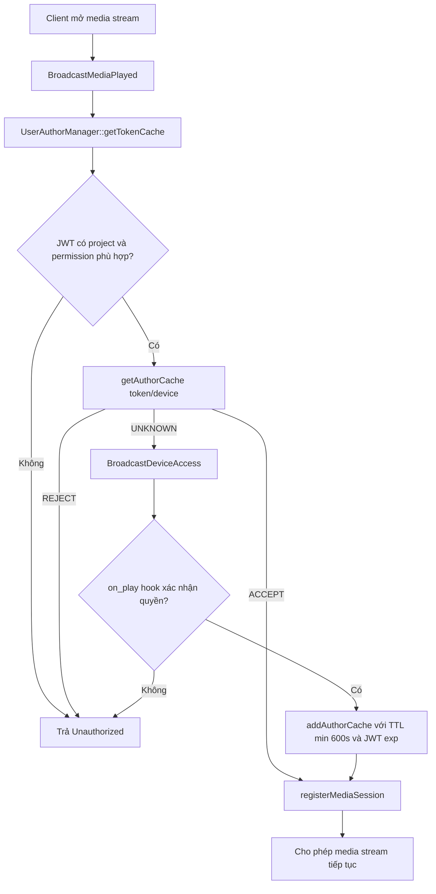
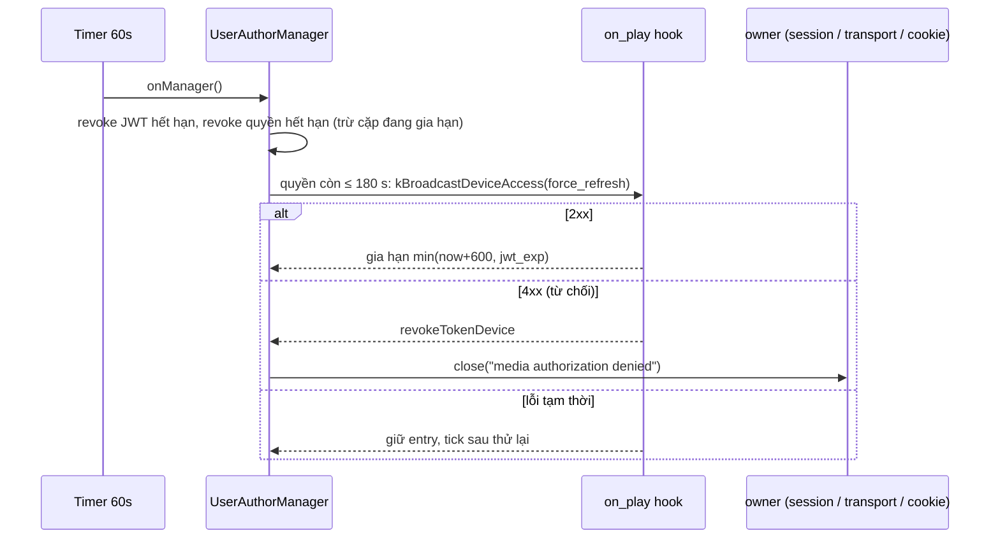
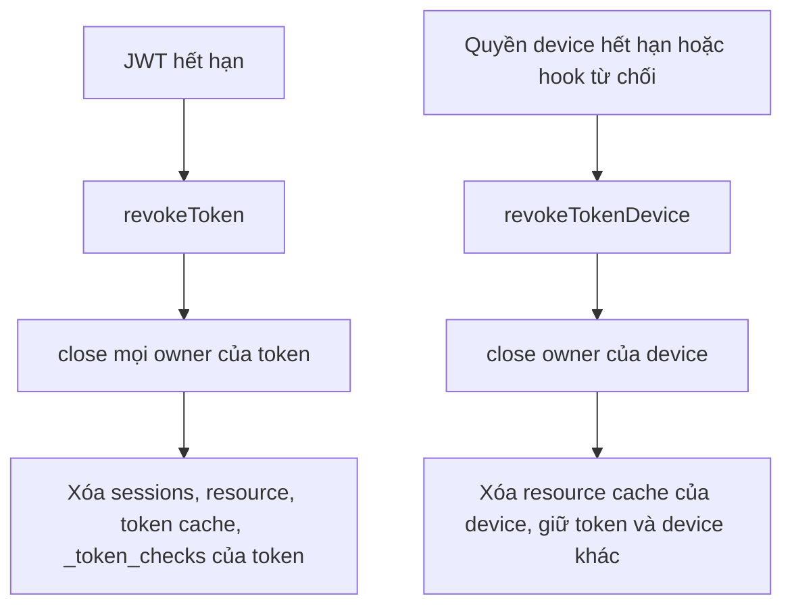

# UserAuthorManager – luồng quản lý token và quyền camera

Tài liệu này mô tả cách `managerkit::UserAuthorManager` quản lý JWT cache, cache quyền theo camera và các media session đang sử dụng token.

## 1. Các loại dữ liệu trong manager

| Thành phần | Khóa | Giá trị | Mục đích |
| --- | --- | --- | --- |
| `_map_token_cache` | JWT token | `UserSessionCache::Ptr` | Lưu thông tin user được giải mã từ JWT. `_expired_at` trong object này là thời điểm `exp` của JWT, không phải TTL của cache quyền. |
| `_map_token_resource` | token → device id | `{permit, expired_time}` | Lưu kết quả kiểm tra quyền camera và thời điểm cần kiểm tra lại. Đây là cache quyền theo resource. |
| `_map_token_sessions` | JWT token | danh sách `{device_id, weak owner, close}` | Theo dõi đối tượng đang mang media của token để đóng khi quyền bị thu hồi. `owner` là session RTSP/RTMP/HTTP-FLV, transport WebRTC hoặc cookie HLS (xem mục 4). |
| `_token_checks` | `token:device` | tập khóa | Chống gửi trùng request kiểm tra khi request trước vẫn đang xử lý. |

Thời hạn quyền camera được tính theo công thức:

```text
resource_expired_at = min(now + 600 giây, jwt_expired_at)
```

JWT không được gia hạn. Chỉ thời điểm kiểm tra lại quyền camera được lưu trong `_map_token_resource`.

## 2. Pipeline xác thực media



`registerMediaSession()` chỉ lưu `weak_ptr`, vì vậy manager không giữ session sống thêm ngoài vòng đời socket.

## 3. Pipeline timer và gia hạn quyền

Timer của manager chạy mỗi 60 giây trên một poller của `EventPollerPool`. Mỗi tick:

1. Nếu `auth.enableAuthorize` đã bị tắt khi đang chạy: xoá `_map_token_resource` và
   `_map_token_sessions` **mà không đóng session**.
2. `cleanExpiredTokenCache()`: JWT đã tới `exp` → `revokeToken()` đóng mọi phiên của token.
3. `cleanExpiredAuthorCache()`: quyền theo device đã hết hạn → `revokeTokenDevice()`. **Bỏ qua**
   cặp `token:device` còn trong `_token_checks` (đang chờ hook trả lời); lần trả lời đó quyết định.
4. `checkActiveTokenAuthorizations()`: với mỗi phiên còn sống, nếu quyền còn ≤ 180 s
   (`kAuthorizationRefreshLeadTime`) và JWT **không** sắp hết hạn trong 180 s thì phát
   `kBroadcastDeviceAccess` với `force_refresh=true` để gọi hook `on_play`.

180 s ≥ 2 chu kỳ timer + timeout hook (10 s), nên mỗi cặp có 2–3 lần thử trước khi hết hạn.
Lần thử lại tự xảy ra ở tick sau, vì callback đã xoá khoá khỏi `_token_checks`.

Kết quả của hook khi gia hạn:

| Hook trả về | Xử lý |
|---|---|
| 2xx | `addAuthorCache(..., only_if_active=true)`: ghi hạn mới `min(now + 600, jwt_exp)` nếu entry ACCEPT **còn tồn tại** (có thể vừa quá hạn). Entry đã bị revoke thì không hồi sinh. |
| 4xx, trừ 408/429 (backend từ chối) | `revokeTokenDevice()` ngay, không chờ hết hạn. |
| Lỗi mạng, 5xx, 408, 429, JSON hỏng | Giữ nguyên entry. Tick sau thử lại; hết hạn mà vẫn chưa gia hạn được thì bước 3 revoke. |



JWT không được gia hạn: một phiên sống tối đa tới `exp` của JWT đã dùng để mở nó. Client muốn xem
tiếp sau thời điểm đó phải mở lại phiên bằng token mới.

## 4. Đối tượng bị đóng khi thu hồi

Listener `kBroadcastMediaPlayed` đăng ký session gửi yêu cầu phát (`registerMediaSession`). Với
WebRTC và HLS, session đó không phải thứ mang media, nên đăng ký được **chuyển** sang đối tượng thật
qua notice `kBroadcastMediaSessionTransfer` (`UserAuthorManager::transferMediaSession`):

| Giao thức | `owner` | Khi thu hồi |
|---|---|---|
| RTSP, RTMP, HTTP-FLV/WS-FLV, fMP4 | Chính session | `Session::shutdown()` |
| WebRTC (`play_plugin`) | `WebRtcTransportImp` được tạo cho request signaling | `safeShutdown()` |
| HLS (`HttpFileManager`) | Cookie HLS vừa được tạo/chọn | Xoá cookie: segment bị từ chối (`ExpiredSession`), playlist kế tiếp phải xác thực lại |

`close` chạy trong lúc giữ `_mtx`, nên không được blocking hay lấy lock khác: cả ba cách trên đều
chỉ đẩy việc sang poller.



### WebRTC: chưa chạy thật — kiểm lại khi phát triển tính năng WebRTC

Phần WebRTC ở trên (2026-09-30, commit `0c247111`) mới chỉ **biên dịch được**. RTSP, HTTP-FLV và
HLS đã chạy thật; WebRTC thì chưa, vì mọi build dir đang tắt `ENABLE_WEBRTC`. Trước khi đưa WebRTC
vào dùng, cần làm các việc sau:

1. Build với `-DENABLE_WEBRTC=ON -DENABLE_RTPPROXY=ON`. Thiếu `ENABLE_RTPPROXY` thì build hỏng, vì
   `webrtc/WebRtcTalk.h` dùng `RtpSender` mà class này chỉ có khi bật RTP proxy.
2. Phát bằng `/index/api/webrtc?type=play` và bằng WHEP (`/index/api/whep`), có `token` trong URL,
   dùng harness `tests/integration/e2e_real` (camera giả, `deny_users.json`, `hook_fault.json`).
   Kiểm cả ba kịch bản:
   - Hook chậm hoặc 5xx ngắn hạn: phiên vẫn sống.
   - Hook từ chối (4xx): transport bị `safeShutdown` trong ≤ 60 s.
   - JWT hết hạn: transport bị đóng.
3. Kiểm log có dòng `Revoked media access ...`, và phía client thấy peer connection bị đóng thật.
   Chỉ riêng request HTTP signaling bị đóng thì chưa đủ.
4. **Signaling qua `WebRtcSignalingPeer` (room/P2P) chưa được bảo vệ:** sender ở đường này là một
   `TcpClient` chứ không phải `Session`, nên listener play không đăng ký gì và phiên không bao giờ bị
   thu hồi. Ngoài ra `play_plugin` đang `static_pointer_cast<Session>` trên sender đó, tức là cast sai
   kiểu (có từ trước). Cần sửa trước khi bật tính năng room.

## 5. Threading

- Mọi truy cập map đều nằm trong `_mtx` (recursive). `revokeTokenDevice()` là public và tự lock.
- `getTokenCache()` dựng `UserSessionCache` (verify RSA) **ngoài** lock rồi `emplace`; hai request
  cùng token chạy song song thì bản chèn trước thắng.
- `UserSessionCache::saveUserSession()` (ghi SQLite) chạy trên `BlockingExecutors::api()`, không
  chạy trên poller của session.
- `checkActiveTokenAuthorizations()` lấy snapshot dưới lock rồi nhả lock trước khi phát event, nên có
  thể tạo một lần kiểm tra dư nếu request khác vừa gia hạn. `_token_checks` chặn gửi trùng đồng thời.

## 6. Invariant cần giữ

1. Không bao giờ cập nhật `_expired_at` để kéo dài JWT. Verify JWT cho leeway 300 s với `nbf`/`iat`
   nhưng leeway 0 với `exp`, trùng thời điểm revoke.
2. Mọi truy cập đến các map của manager phải nằm trong `_mtx`.
3. Chỉ owner còn sống mới được `close`.
4. Một cặp `token:device` chỉ có tối đa một lần kiểm tra đang chạy nhờ `_token_checks`.
5. TTL quyền camera không được vượt quá thời điểm hết hạn của JWT.
6. Không log JWT.
